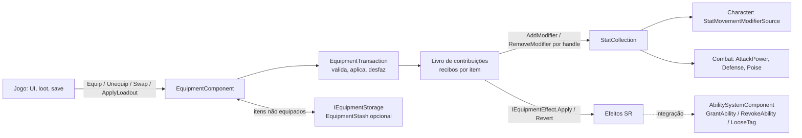

# M7 — Equipment · Especificação técnica

- **Status:** **v1 — proposta para auditoria arquitetural** (nenhum código; ADRs 0033–0037 propostas) ·
  **Data:** 2026-10-14
- **Unity:** 6000.6.5f1 · **Package:** `com.ramirestechgames.equipment` (L5, `RamiresTechGames.Equipment`, define
  `RAMIRESTECHGAMES_EQUIPMENT`)
- **Dependências (grafo, sem mudança):** hard `core`, `stats`; opcional `abilities` (ADR-0002), exatamente como em
  `dependency-graph.json`. **Character e Combat não entram no grafo do Equipment** (§12.3–12.4): os efeitos de um
  equipamento sobre movimento e combate passam pelo Stats e pelas habilidades concedidas.
- **Base contratual:** Core 0.4.0, Stats 0.1.1, Abilities 0.1.0 (candidatas, sem tags); Character 0.2.0 e Combat
  0.1.0 só como consumidores do Stats. **Nenhuma API pública de package existente é alterada**; o que só seria
  resolvido com mudança em outro package está na §19.2, com a alternativa adotada.
- **Fora do package:** itens, cartas, armas, peças de armadura e progressão de um jogo. No Whiskers of Rage, cartas,
  katana, peças da Armadura Sagrada e talentos são **assets e glue do jogo** (§18). Nenhum nome de jogo em código,
  assets ou samples.

---

## 1. Objetivo e escopo

Um **sistema genérico e data-driven para equipar itens em slots** de um ator e aplicar suas contribuições —
modificadores de atributos, habilidades e passivas concedidas, tags e efeitos customizados — com **reversibilidade
exata**: desequipar remove somente o que aquele item contribuiu, sem tocar em modificadores, concessões ou tags de
outras fontes (outros itens, efeitos, scripts do jogo).

### 1.1 Escopo do M7 (fechado)

| Obrigatório no M7 | Adiado (fora do M7) |
|---|---|
| Definições: slot, layout de slots, equipamento, conjunto, loadout | Loot, geração de itens, raridade, afixos aleatórios (o jogo cria as instâncias) |
| `EquipmentItem` (instância com identidade, nível e modificadores próprios) | Economia, loja, crafting, durabilidade, reparo |
| `EquipmentComponent`: slots, equipar, desequipar, trocar, loadouts, habilitar/desabilitar contribuições | Inventário completo (grade, peso, empilhamento, categorias de UI) e UI de inventário |
| Restrições: categoria do slot, ocupação de vários slots, unicidade, requisitos (SR) no ato de equipar | Requisitos reavaliados continuamente com suspensão automática (§6.5) |
| **Livro de contribuições** com recibos e reversão por handle (normativo, §8) | Persistência (salvar/carregar): o package expõe o estado, o jogo serializa (§11.3) |
| Modificadores do Stats por item, por nível e por instância; ressincronização no `Rebuild` | Troca de moveset/combo do Combat (exige API nova no Combat, §19.2) |
| Bônus de conjunto por limiar de peças | Armadura de combate concedida por equipamento (`GrantArmor` adiado no M5, §19.2) |
| `EquipmentStash` opcional (armazenamento simples de instâncias) | Rede/rollback (R14) |
| Integração Abilities: habilidades ativas, passivas, tags possuídas, requisitos por tags | Integration assemblies com Character, Combat, HFSM ou AI |
| Ferramentas: inspectors, Equipment Debugger, validators; samples Equipment Basics e Equipment Abilities | Editor gráfico dedicado (não há grafo no domínio) |

---

## 2. Conceitos

| Termo | Definição |
|---|---|
| **Definição de equipamento** | `EquipmentDefinition` (SO, imutável): categoria, ocupação, modificadores por nível, efeitos (SR), conjunto, requisitos. |
| **Item** | `EquipmentItem`: instância de runtime de uma definição, com `ItemId`, nível e modificadores próprios. Um item está em **no máximo um lugar** (um slot ou um armazenamento). |
| **Slot** | Posição nomeada de um ator (ex.: "mão principal", "carta 3"). Definido por `EquipmentSlotDefinition`; um layout lista os slots do ator. |
| **Ocupação** | Slots que um item equipado ocupa: o slot principal e, opcionalmente, outros (ex.: arma de duas mãos bloqueia a mão secundária). |
| **Contribuição** | Algo que um item aplica ao ator ao ser equipado: modificador de stat, concessão de habilidade, tag possuída, efeito customizado. |
| **Recibo** | Registro de uma contribuição aplicada, com o handle que permite revertê-la exatamente (`ModifierHandle`, `AbilityHandle`, `LooseTagHandle` ou recibo de efeito customizado). |
| **Livro de contribuições** | Lista de recibos por item equipado (e por bônus de conjunto). Desequipar = reverter os recibos daquele livro, em ordem inversa. |
| **Transação** | Operação atômica (`Equip`, `Unequip`, `Swap`, `ApplyLoadout`): valida, aplica, e em falha desfaz tudo; ou acontece inteira, ou o estado não muda. |
| **Conjunto** | `EquipmentSetDefinition`: itens com o mesmo conjunto somam peças; limiares (2, 4…) concedem contribuições próprias. |
| **Loadout** | Configuração de slots → itens (definição como asset; estado capturado em runtime). |
| **Armazenamento** | Onde ficam itens não equipados. Contrato `IEquipmentStorage`; implementação opcional `EquipmentStash`. |

---

## 3. Arquitetura

### 3.1 Assemblies

| Assembly | Conteúdo | Referências |
|---|---|---|
| `RamiresTechGames.Equipment` | Domínio (puro): definições, `EquipmentItem`, slots, transações, livro, requisitos e efeitos incluídos; componentes `EquipmentComponent` e `EquipmentStash` | Core, Stats |
| `RamiresTechGames.Equipment.Editor` | Inspectors, Equipment Debugger, validators de cena, menus | Equipment, Core.Editor |
| `RamiresTechGames.Equipment.Integration.Abilities` | Efeitos `GrantAbilityEffect`, `GrantPassiveAbilityEffect`, `GrantOwnedTagsEffect`; requisito `OwnedTagsRequirement` | Equipment, Abilities (define `RAMIRESTECHGAMES_ABILITIES`) |
| Testes | `Tests.Editor`, `Tests.Runtime`, `Tests.Runtime.Integration` (Abilities) | — |

### 3.2 Camadas e responsabilidades



- O **domínio é puro**: `EquipmentSlots`, `EquipmentLedger`, `EquipmentTransaction` e regras recebem as dependências
  (coleção do Stats, armazenamento, alvos dos efeitos) e não leem a cena.
- O `EquipmentComponent` integra: resolve `StatsComponent` (e, pela integração, o `AbilitySystemComponent`) no mesmo
  GameObject, aplica o loadout inicial, acompanha `StatsComponent.Rebuilt` e expõe a API e os eventos.
- **Sem tick.** O Equipment não roda em `Update` nem em `FixedUpdate`; tudo acontece dentro das chamadas da API
  (§13.1). Por isso não recebe banda de execução; a ordem relevante é a de inicialização (§13.2).

### 3.3 Por que um livro de recibos

O Stats já garante que remover todos os modificadores de uma fonte iguala a coleção que nunca os recebeu (Stats,
garantia 2), e o Abilities garante que revogar uma concessão remove suas passivas e que tags somam por fonte (Abilities,
garantias 8 e 22). O que falta é **um único dono** que saiba, para cada item, **quais** handles criou em **quais**
sistemas, e que os reverta todos — inclusive quando uma aplicação falha no meio, quando a coleção do Stats é
reconstruída ou quando o componente é desabilitado. Esse dono é o livro (ADR-0033).

---

## 4. Definições (ScriptableObjects, imutáveis em runtime)

Todas implementam `IValidatable`, têm `StableId` (GUID do asset, mesmo mecanismo das definições do Stats) e
menus pelas constantes de `EquipmentPackageInfo` (`CREATE_ASSET_MENU_ROOT`, `COMPONENT_MENU_ROOT`,
`TOOLS_MENU_ROOT`).

### 4.1 `EquipmentSlotDefinition`

| Campo | Tipo | Descrição |
|---|---|---|
| `DisplayName` | string | Nome para ferramentas e UI do jogo. |
| `AcceptedCategories` | `GameplayTagSet` | Categorias aceitas (consulta hierárquica do Core: `Weapon` aceita `Weapon.Sword`). Vazio = aceita qualquer item. |
| `RejectedCategories` | `GameplayTagSet` | Categorias recusadas (vence `AcceptedCategories`). |

### 4.2 `EquipmentSlotLayoutDefinition`

Lista ordenada de entradas (`Slot`, `Count`): "Carta × 10" gera os slots `Carta[0..9]`. Herança opcional
(`ParentLayout`) como no `StatSetDefinition`, para variações de arquétipo. O índice do slot no layout expandido é a
ordem total usada em loadouts, eventos e ferramentas.

### 4.3 `EquipmentDefinition`

| Campo | Tipo | Descrição |
|---|---|---|
| `Category` | `GameplayTag` | Categoria do item, comparada com as do slot. |
| `Tags` | `GameplayTagSet` | Tags descritivas (consultas do jogo, unicidade). |
| `AlsoOccupies` | lista de `EquipmentSlotDefinition` | Slots adicionais ocupados enquanto equipado (§6.2). |
| `UniqueGroup` / `UniqueLimit` | `GameplayTag` / int | No máximo `UniqueLimit` itens equipados do mesmo grupo (§6.3). 0 = sem limite. |
| `MaxLevel` | int | Nível máximo da instância (≥ 1). |
| `Modifiers` | lista de `EquipmentModifierEntry` | Stat, operação (`Flat`/`Additive`/`Multiplicative`), valor e curva por nível opcional (§8.3). |
| `Effects` | lista SR de `IEquipmentEffect` | Contribuições não-Stats (§8.4); incluídas: nenhuma no domínio, três na integração Abilities. |
| `Requirements` | lista SR de `IEquipRequirement` | Avaliadas ao equipar (§6.4). |
| `Set` | `EquipmentSetDefinition` | Conjunto do item (opcional). |

### 4.4 `EquipmentSetDefinition`

Limiares ordenados (`Pieces`, `Modifiers`, `Effects`): ao atingir `Pieces` itens equipados do conjunto, as
contribuições do limiar são aplicadas com livro próprio; ao cair abaixo, revertidas (§9). Peças são contadas por
**definição distinta** (dois itens iguais contam como uma peça; ver D11).

### 4.5 `EquipmentLoadoutDefinition`

Entradas (`Slot`, `SlotIndex`, `Equipment`, `Level`) para um layout. Usado como loadout inicial do componente e em
`ApplyLoadout` (§11). Os itens de um loadout-asset são **criados** pelo componente (ids de runtime, §5.2).

---

## 5. Instâncias, identidade e handles

### 5.1 `EquipmentItem`

Classe pura: `Definition`, `ItemId`, `Level`, `InstanceModifiers` (somente leitura após criação), `Location`
(`None`, `Slot`, `Storage`), `IsEquipped`. Criação por `EquipmentItem.Create(definition, level, itemId,
instanceModifiers)`. O package **não** sorteia nada: modificadores de instância (afixos, rolagens) vêm prontos do jogo.

Cada item é a **fonte** (`IModifierSource`) dos próprios modificadores e a `source` das próprias concessões no
Abilities — comparadas por referência. Dois itens da mesma definição são fontes distintas.

### 5.2 Identidade

`ItemId` (`ulong`, ≠ 0) identifica a instância no ator e no armazenamento. O jogo fornece ids (save, rede futura);
itens criados por loadouts-asset recebem ids de runtime do componente (faixa alta, sequência determinística por
ordem de slot). Id duplicado no mesmo componente/armazenamento é recusado (`DuplicateItemId`).

### 5.3 Handles

`EquippedItemHandle` = (dono, índice do slot principal, geração). Inválido depois de desequipar; handles antigos,
estrangeiros ou inválidos não agem (mesmo padrão de `ModifierHandle`, `ActiveEffectHandle`, `AIEntityHandle`).

---

## 6. Slots, ocupação e restrições

### 6.1 Aceitação pelo slot
Um item é aceito por um slot se `Category` casa (hierarquicamente) com `AcceptedCategories` (ou ela está vazia) e
não casa com `RejectedCategories`. Sem categoria, só slots sem filtro o aceitam.

### 6.2 Ocupação de vários slots
`AlsoOccupies` lista slots (por definição) que o item bloqueia; resolvidos no layout como a **primeira instância
livre** de cada definição, em ordem de índice. Equipar em um slot cujo bloqueio já existe exige liberar os itens que
ocupam os slots bloqueados — o chamador escolhe a política: `Fail` (padrão) ou `DisplaceToStorage` (os ocupantes vão
para o armazenamento na mesma transação).

### 6.3 Unicidade
Com `UniqueGroup`, no máximo `UniqueLimit` itens equipados do grupo (inclusive o que entra). Trocar um item por outro
do mesmo grupo no mesmo slot não conta duas vezes.

### 6.4 Requisitos (`IEquipRequirement`, SR)
`bool IsSatisfied(in EquipRequirementContext context, out EquipFailureDetail detail)` + `Validate`. Puros, sem
alocação, avaliados **uma vez, na validação da transação**, contra o estado atual do ator **antes** das contribuições
do item. Incluídos: `StatRequirement` (stat ≥/≤ valor, lido do `IStatValueSource`), `AllRequirements`/
`AnyRequirement` (composição); na integração Abilities, `OwnedTagsRequirement` (`TagRequirements` do Abilities).

### 6.5 Requisitos depois de equipar (decisão D8)
Na 0.1.0 os requisitos **não** são reavaliados depois de equipar: um item que exigia Força 10 continua equipado se a
Força cair. Reavaliação com suspensão automática exigiria ler o valor do stat **sem** as contribuições do próprio item
(o Stats não oferece essa consulta) e cria laços (o item satisfaz o próprio requisito). O jogo pode desequipar ou
desabilitar (§7.6) por regra própria. Registrado como adiado (R48).

---

## 7. Transações (normativo, ADR-0034)

### 7.1 Operações

| Operação | Efeito | Falha possível |
|---|---|---|
| `TryEquip(item, slot, options)` | Coloca o item no slot (e nos ocupados), aplica contribuições | sim — estado intacto |
| `Unequip(handle, destination)` | Reverte contribuições, libera slots, entrega o item ao destino | só por destino cheio (verificado antes) |
| `TrySwap(handle, item, options)` | Troca o item de um slot por outro em uma transação | sim — estado intacto |
| `TryApplyLoadout(loadout, policy)` | Aplica várias trocas de uma vez (`ReplaceAll` ou `FillEmpty`) | sim — estado intacto |
| `SetContributionsEnabled(handle, enabled)` | Reverte/reaplica as contribuições sem desequipar | reaplicar pode falhar — item fica desabilitado |

Resultado: `EquipResult` (`Succeeded`, `Reason`: `EquipFailureReason`, `Detail`, `Handle`). Motivos:
`InvalidItem`, `AlreadyPlaced`, `DuplicateItemId`, `SlotNotFound`, `SlotRejectsCategory`, `SlotsBlocked`,
`UniqueLimit`, `RequirementNotMet`, `LevelOutOfRange`, `ContributionFailed`, `StorageFull`, `LedgerFull`,
`Reentrant`, `ComponentDisabled`.

### 7.2 Etapas de uma transação
1. **Validação** (sem efeitos colaterais): item, slot, ocupação, unicidade, requisitos, nível, capacidade do livro e do
   armazenamento de destino.
2. **Lote do Stats aberto** (`StatCollection.BeginBatch`): `StatChanged` é coalescido e entregue uma vez ao fechar.
3. **Aplicar o novo** (make-before-break, D6): modificadores (por item: definição → nível → instância), depois efeitos
   em ordem de lista; cada aplicação produz um recibo no livro **antes** da próxima.
4. **Reverter o antigo** (troca/loadout): recibos do item que sai, em ordem inversa.
5. **Conjuntos**: recontagem de peças; limiares cruzados aplicam/revertem seus livros.
6. **Commit**: slots, locais dos itens, gerações dos handles; armazenamento atualizado.
7. **Lote fechado**; **eventos** do Equipment entregues em ordem fixa (§7.4).

Se a etapa 3 ou 5 falhar (concessão sem vaga, tag solta sem vaga, efeito customizado recusado), **todos os recibos
criados nesta transação são revertidos em ordem inversa**, nada é comitado e `EquipFailed(ContributionFailed)` é
emitido. Como o novo é aplicado antes de o antigo sair, uma falha nunca exige "re-equipar" o antigo — o que
reiniciaria cooldowns e cargas das habilidades dele.

### 7.3 Custos do make-before-break
Durante a transação, novo e antigo coexistem: uma troca pode falhar por capacidade (no Abilities 0.1.0, concessões
por ator configuráveis — padrão 16 — e tags soltas fixas em 16) mesmo que o estado final coubesse. Documentado (R46); o validator do
`EquipmentComponent` avisa quando o pior caso do layout excede as capacidades do ator.

### 7.4 Eventos
Ordem por transação: `Unequipped` (itens que saíram, por índice de slot) → `Equipped` (itens que entraram) →
`SetBonusChanged` → `Changed` (um por transação). Falha: só `EquipFailed`. Args são structs; listeners **não** podem
abrir outra transação no mesmo componente durante a entrega (retorna `Reentrant`); podem usar
`EquipmentComponent.Enqueue(...)`, executado em FIFO depois da transação atual (mesmo padrão de reentrância do Stats).

### 7.5 Recursos (Stats)
Mudar o máximo de um recurso (ex.: +Vida Máxima) segue a `ResourceMaxChangePolicy` do recurso (`Clamp`,
`PreserveRatio`, `AddDifference`). **O Equipment não restaura `Current`**: equipar +50 de vida máxima com
`AddDifference`, curar e desequipar deixa o valor atual limitado ao novo máximo. Isso é a garantia do Stats ("não se
promete restaurar `Current`") tornada explícita no contrato do Equipment (R45).

### 7.6 Habilitar/desabilitar
`SetContributionsEnabled(handle, false)` reverte o livro do item sem desequipá-lo (slot continua ocupado, peça do
conjunto deixa de contar). `true` reaplica em transação (pode falhar por capacidade; o item fica desabilitado e o
motivo é reportado). `EquipmentComponent.OnDisable` desabilita todos; `OnEnable` reaplica; `OnDestroy` reverte sem
reaplicar (alvos já destruídos são tolerados e contados).

---

## 8. Contribuições e reversibilidade (normativo, ADR-0033)

### 8.1 Invariantes
- **I1 — Isolamento:** depois de desequipar (ou desabilitar) um item, todo stat tem o valor **bit a bit** igual ao de
  uma coleção que recebeu as mesmas outras contribuições e nunca recebeu as do item (Stats, garantia 2), em qualquer
  ordem de equipar/desequipar.
- **I2 — Sem efeitos sobre outras fontes:** nenhuma operação do Equipment remove modificadores, concessões ou tags que
  ele não criou. O Equipment nunca chama `RemoveModifiersFromSource`, `RevokeAbilitiesFromSource` ou
  `RemoveEffectsWithTags` com fontes que não sejam as próprias instâncias; a reversão normal é **por handle**.
- **I3 — Livro exato:** cada contribuição aplicada tem exatamente um recibo; cada recibo é revertido exatamente uma vez;
  o livro de um item fora de um slot (ou desabilitado) está vazio.
- **I4 — Atomicidade:** uma transação que falha deixa slots, armazenamento, livros, stats, concessões e tags iguais ao
  estado anterior.
- **I5 — Rebuild:** depois de `StatsComponent.Rebuild`, os modificadores dos itens equipados e habilitados estão na
  coleção nova, sem duplicação (handles do livro substituídos).

### 8.2 Recibos
`EquipmentReceipt` (struct): tipo (`StatModifier`, `Effect`), índice da contribuição, handle do Stats ou dados do
efeito (`EquipmentEffectToken`: inteiro + objeto opaco, sem alocação). Livro por item com capacidade fixa
(`MaxContributionsPerItem`, padrão 32; validator acusa definições que excedem).

### 8.3 Modificadores do Stats
Para cada `EquipmentModifierEntry` e cada modificador de instância: `StatCollection.TryAddModifier(stat,
new StatModifier(op, value(level), source: item))` → `ModifierHandle` no recibo. Stat ausente na coleção do ator:
política do componente `MissingStatPolicy` = `Skip` (aviso uma vez, contado; padrão) ou `Fail` (`ContributionFailed`).
Reversão: `RemoveModifier(handle)`. Rede de segurança no `OnDestroy`: `RemoveModifiersFromSource(item)` — só a
própria instância.

No `Rebuilt` do `StatsComponent`, o componente reaplica na coleção nova os modificadores dos itens habilitados e dos
limiares de conjunto ativos e troca os handles nos recibos (ADR-0033; mesmo padrão do Abilities, garantia 11). Efeitos
customizados recebem `OnStatsRebuilt` se implementarem `IStatsRebuildAware`.

### 8.4 Efeitos (`IEquipmentEffect`, SR — extension point)
```
bool Apply(in EquipmentEffectContext context, out EquipmentEffectToken token);
void Revert(in EquipmentEffectContext context, in EquipmentEffectToken token);
void Validate(ValidationReport report, UnityEngine.Object owner, string label);
```
Contrato: `Apply` é tudo-ou-nada (retorna false sem efeito residual); `Revert` desfaz exatamente o que o `Apply`
correspondente fez, usando só o token; nenhum dos dois aloca em regime nem abre transação do Equipment. O contexto
traz o componente, o item, o nível, o `StatCollection` e `TryGetTarget<T>()` (componentes do ator com cache por tipo).
Efeitos do jogo (trocar visual, tocar som ao equipar) implementam esta interface no código do jogo.

### 8.5 Abilities (integração, ADR-0035)
| Efeito | Apply | Revert | Observações |
|---|---|---|---|
| `GrantAbilityEffect` | `GrantAbility(ability, level ou nível do item, inputTag, source: item)` → `AbilityHandle` | `RevokeAbility(handle)` | Execução em andamento termina com `Revoked`, sem reembolso (Abilities); cooldown/cargas são da concessão e somem com ela (R44). |
| `GrantPassiveAbilityEffect` | concessão de habilidade `Passive` | `RevokeAbility(handle)` | **Forma suportada de "efeito enquanto equipado"**: as `PassiveEffects` entram na A2 seguinte e saem na revogação (Abilities, garantia 22). |
| `GrantOwnedTagsEffect` | `AddLooseTag` por tag → `LooseTagHandle`s | `RemoveLooseTag` por handle | Tags somam por fonte; remover uma não afeta a mesma tag de outra fonte (Abilities, garantia 8). |

**Não há `ApplyGameplayEffectEffect`**: `AbilitySystemComponent.ApplyEffect` retorna só `bool` (aplicação na caixa de
entrada, sem handle) e a remoção por tags afeta outras fontes — não seria reversível com exatidão (§19.2).

### 8.6 Ordem de reversão
Inversa à de aplicação (efeitos da lista do fim para o começo, depois modificadores de instância, nível e definição).
Como Stats é comutativo e o Abilities conta por fonte, a ordem não muda o resultado; é fixada para determinismo dos
eventos de outros packages (ex.: `AbilityRevoked` antes de `StatChanged`).

---

## 9. Conjuntos

`EquipmentSetTracker` conta, por conjunto, as **definições distintas** equipadas e habilitadas. Cruzar um limiar
para cima aplica as contribuições do limiar (livro do conjunto, fonte = objeto de estado do limiar no ator); cruzar para
baixo reverte. Contribuições de limiar seguem as mesmas invariantes (I1–I5) e entram na mesma transação (falha em um
limiar desfaz a transação inteira). Limiares são cumulativos (2 e 4 peças: com 4, ambos ativos) — D12.

---

## 10. Armazenamento e o limite com inventário (ADR-0036)

- O `EquipmentComponent` **não guarda** itens não equipados. `Unequip` e trocas recebem um destino
  `IEquipmentStorage` (`CanStore`, `Store`, `Remove`, `Contains`, `Count`, `Capacity`) ou `null` (o item fica solto e
  o jogo o administra).
- `EquipmentStash` (MB opcional): lista ordenada de `EquipmentItem` com capacidade, ids únicos, eventos `Added`/
  `Removed`. Serve a samples e a jogos simples (ex.: cartas obtidas numa run).
- **Fora do package:** grade, peso, empilhamento, ordenação para UI, filtros, economia. Jogos com inventário próprio
  implementam `IEquipmentStorage`.
- O M0 dizia "não faz inventário": a proposta mantém isso para inventário completo e adiciona só o contrato de
  armazenamento + uma implementação mínima (D9, para a auditoria).

---

## 11. Loadouts

### 11.1 Asset
`EquipmentLoadoutDefinition` (§4.5) — loadout inicial (`InitialLoadout` do componente, aplicado no `Start`) e
predefinidos (ex.: dois conjuntos de armas).

### 11.2 Aplicação
`TryApplyLoadout(source, policy, storage)` em **uma transação**: `ReplaceAll` (o que não está no loadout sai para o
armazenamento) ou `FillEmpty` (só slots vazios). Fonte = asset (cria itens) ou `EquipmentLoadoutState` (usa itens já
existentes do armazenamento por `ItemId`).

### 11.3 Estado capturado
`CaptureLoadout()` → `EquipmentLoadoutState` (dados puros: por slot, `ItemId`, `StableId` da definição, nível,
modificadores de instância, habilitado). O jogo serializa como quiser; o package não lê nem grava disco (D10).

---

## 12. Integrações

### 12.1 Stats (hard)
Fonte dos modificadores, requisitos por stat, `Rebuild`. Nenhuma API nova.

### 12.2 Abilities (opcional, `Integration/Abilities`)
§8.5 e `OwnedTagsRequirement`. Nenhuma API nova; capacidades de concessão e tags soltas do ator são as do Abilities.

### 12.3 Character (sem integration assembly)
Velocidade, aceleração e altura de pulo já vêm de stats pelo `StatMovementModifierSource` (Character, integração
Stats): um item de +10% de velocidade é um modificador no stat que essa fonte lê. Habilidades de movimento concedidas
usam a integração Abilities ↔ Character existente. Nenhuma aresta nova no grafo.

### 12.4 Combat (sem integration assembly)
Dano, defesa, poise e guarda vêm de stats (`AttackPowerStat`, `DefenseStat`, recursos do `CombatProfileDefinition`):
uma arma de +5 de ataque é um modificador. **Golpes de arma** = habilidades concedidas com `PerformAttackAction`
(integração Abilities ↔ Combat existente). **Trocar o moveset/combo do `CombatController`** não é possível sem API nova
no Combat (`Moves`/`Combo` são somente leitura): adiado, com a alternativa acima (§19.2, R47).

### 12.5 HFSM e AI
Nenhuma integração. A IA pode consultar o `EquipmentComponent` por condições do jogo; a HFSM consome as bordas das
habilidades concedidas como de qualquer outra concessão.

---

## 13. Tempo, determinismo e desempenho

### 13.1 Sem tick (ADR-0034)
Transações são **síncronas** na chamada. Efeitos temporais pertencem aos packages-alvo: modificadores valem
imediatamente; passivas entram na A2 seguinte do Abilities; uma concessão revogada no meio de uma execução encerra-a na
chamada. Para mudanças durante o combate com resultado igual em qualquer frame rate, o jogo chama a API no passo fixo
(ex.: em `DECISION`/`STATE_MACHINE`); a API em `Update` (UI) é válida e seu efeito é visível no passo seguinte.

### 13.2 Inicialização
`Awake`: layout, slots, livros pré-alocados. `OnEnable`: resolve `StatsComponent` (e alvos de efeitos sob demanda),
inscreve em `Rebuilt`, reaplica habilitados. `Start`: aplica `InitialLoadout` (depois de todos os `Awake`, quando o
Stats já criou a coleção). Sem `[DefaultExecutionOrder]`; o componente não depende da ordem de `Start` de outros.

### 13.3 Determinismo
Sem aleatoriedade no package. Mesma sequência de chamadas ⇒ mesmos estados, eventos e handles; ordens totais por
índice de slot e posição na lista de contribuições.

### 13.4 Desempenho e alocação
- Zero GC em regime para `TryEquip`, `Unequip`, `TrySwap`, `SetContributionsEnabled` e `TryApplyLoadout` com itens
  existentes (livros, listas de validação e args pré-alocados; Stats e Abilities sem GC nas operações usadas).
- Fora do regime (intencional): criação de itens, primeira inicialização, `Rebuild` do Stats, ferramentas.
- Custo: O(contribuições do item) por transação; nada por frame.

---

## 14. Ferramentas de autoria

| Ferramenta | Conteúdo |
|---|---|
| Inspector de `EquipmentDefinition` | Categoria e slots compatíveis do projeto, ocupação, modificadores com prévia por nível (tabela nível × valor), efeitos/requisitos com o seletor SR do Core, conjunto |
| Inspector de layout e loadout | Slots expandidos com índice; loadout em tabela slot → item com checagem de compatibilidade em tempo real |
| Inspector de `EquipmentComponent` (Play Mode) | Slots, itens, habilitado, livro por item (recibos com handle e estado), limiares de conjunto ativos, botões Equip/Unequip/Disable para teste |
| **Equipment Debugger** (`Tools/RamiresTech Games/Equipment/Equipment Debugger`) | Atores com equipamento, histórico das últimas 64 transações (resultado, motivo, recibos aplicados/revertidos), contadores (`ContributionFailedCount`, `MissingStatCount`, `RevertTargetMissingCount`) |
| Validators (Core) | Slot sem categorias e layout vazio (aviso), ids de slot duplicados, item sem categoria (aviso), item que nenhum slot do projeto aceita, modificador sem stat ou com valor inválido, efeito/requisito SR vazio ou de tipo ausente, `AlsoOccupies` com o próprio slot, conjunto com limiares fora de ordem ou repetidos, loadout com item incompatível, contribuições acima da capacidade; na cena: componente sem `StatsComponent`, stats dos itens do loadout inicial ausentes no `StatSet` do ator, pior caso de concessões/tags acima das capacidades do `AbilitySystemComponent` |

Sem editor gráfico: não há grafo no domínio (o caso comum se monta pelo Inspector — QG11).

---

## 15. Samples

- **Equipment Basics** (Stats): um ator com layout (arma, escudo, armadura, 2 anéis), um `EquipmentStash` e um painel
  com stats e a decomposição por fonte (`GetModifiers`); espada de duas mãos bloqueando o escudo, anel único, conjunto
  de 2/3 peças, item com requisito de stat, troca de loadouts com uma tecla, desabilitar/reabilitar um item.
- **Equipment Abilities** (Stats + Abilities): arma que concede um golpe (habilidade ativa por tag de entrada), amuleto
  com passiva (regeneração por efeito), item que concede tag possuída (imunidade), conjunto que concede habilidade no
  limiar; painel com concessões e tags por fonte e prova visual de que desequipar não remove o buff de outra fonte.

Os dois samples ganham smoke tests versionados na Sandbox do host, como os do AI (importação, referências, cena,
Play Mode).

---

## 16. API pública (proposta)

| Tipo | Categoria | Descrição |
|---|---|---|
| `EquipmentSlotDefinition`, `EquipmentSlotLayoutDefinition`, `EquipmentDefinition`, `EquipmentSetDefinition`, `EquipmentLoadoutDefinition` | SO | §4 |
| `EquipmentModifierEntry`, `EquipmentSetThreshold`, `EquipmentLoadoutEntry` | serializable | Entradas das definições |
| `EquipmentItem` | classe | §5.1 |
| `EquippedItemHandle`, `EquipResult`, `EquipFailureReason`, `EquipFailureDetail`, `EquipOptions`, `LoadoutPolicy`, `BlockedSlotPolicy`, `MissingStatPolicy` | structs/enums | §5.3, §6, §7 |
| `EquipmentComponent` | MB | `Layout`, `Slots`, `GetEquipped`, `TryGetItem`, `TryEquip`, `Unequip`, `TrySwap`, `TryApplyLoadout`, `CaptureLoadout`, `SetContributionsEnabled`, `IsEnabled`, `Enqueue`, `GetReceipts`, `ActiveSetThresholds`; eventos `Equipped`, `Unequipped`, `EquipFailed`, `SetBonusChanged`, `Changed`; contadores |
| `IEquipmentStorage`, `EquipmentStash` | interface / MB | §10 |
| `EquipmentLoadoutState` | classe/structs | §11.3 |
| `IEquipmentEffect`, `EquipmentEffectContext`, `EquipmentEffectToken`, `IStatsRebuildAware` | extension point | §8.4 |
| `IEquipRequirement`, `EquipRequirementContext`, `StatRequirement`, `AllRequirements`, `AnyRequirement` | extension point / SR | §6.4 |
| `EquipmentReceipt`, `EquipmentReceiptKind` | struct/enum | Leitura do livro (ferramentas) |
| Integração Abilities: `GrantAbilityEffect`, `GrantPassiveAbilityEffect`, `GrantOwnedTagsEffect`, `OwnedTagsRequirement` | SR | §8.5 |

Toda API nasce `Experimental` 0.1.0.

---

## 17. Qualidade

### 17.1 Estratégia de testes (depois da implementação de cada entrega, sem TDD)
**EditMode (domínio, coleções reais do Stats):** aceitação por categoria hierárquica e rejeição; ocupação de vários
slots com `Fail` e `DisplaceToStorage`; unicidade (troca no mesmo slot não conta duas vezes); requisitos e composição;
níveis e curvas; modificadores de instância; transação com falha em cada etapa (validação, modificador com stat ausente
em `Fail`, efeito recusado no meio da lista, limiar de conjunto recusado) → estado idêntico (I4); make-before-break em
troca e loadout; eventos em ordem e só no sucesso; reentrância (`Reentrant` e `Enqueue` FIFO); habilitar/desabilitar;
conjuntos (cumulativos, definições distintas, cruzar para cima/baixo na mesma transação); captura e reaplicação de
loadout; validators.

**Reversibilidade por modelo de referência (núcleo do M7):** sequências pseudoaleatórias com semente fixa (≥ 500
operações, 3 sementes) de equipar, desequipar, trocar, loadout, desabilitar, `Rebuild`, **com outras fontes ativas**
(modificadores de script e, na integração, efeitos e tags de outras fontes). Depois de cada operação, cada stat é
comparado **bit a bit** com uma coleção de referência reconstruída do zero com as mesmas outras fontes e apenas os
itens equipados e habilitados (I1); os modificadores de outras fontes continuam presentes por handle (I2); o livro
bate com o modelo (I3). Repetido com ordem embaralhada de equipar o mesmo conjunto final.

**Recursos:** as três `ResourceMaxChangePolicy` ao equipar/desequipar um item de máximo (comportamento documentado,
§7.5).

**PlayMode / integração (Abilities real):** concessão ativa com execução em andamento revogada (`Revoked`, sem
reembolso); passiva entra na A2 seguinte e sai na revogação, com o mesmo efeito vindo de outra fonte intacto; tags
soltas com a mesma tag de outra fonte; capacidade de concessões/tags esgotada → `ContributionFailed` com rollback e
nenhum resíduo; `Rebuild` com passivas e itens; zero GC em regime (equipar/desequipar/trocar com 50 atores).

**Sandbox do host (cross-package):** velocidade do Character pelo stat de um item (equipar/desequipar no meio do
movimento); dano do Combat com arma de ataque; golpe concedido por arma via `PerformAttackAction` executado pela HFSM;
smoke tests dos samples.

### 17.2 Critérios de aceite
| # | Critério |
|---|---|
| AC1 | Equipar/desequipar restaura **exatamente** os stats (I1), com outras fontes ativas, em qualquer ordem (modelo de referência). |
| AC2 | Concessões, passivas e tags do item são revogadas ao desequipar; as de outras fontes, intactas (I2). |
| AC3 | Transações atômicas: falha em qualquer etapa deixa o estado idêntico (I4); troca nunca reconcede o item antigo. |
| AC4 | Slots com categoria, ocupação múltipla, unicidade e requisitos, cobertos por testes e validators. |
| AC5 | `StatsComponent.Rebuild` com itens equipados: valores e livros corretos (I5). |
| AC6 | Conjuntos com limiares cumulativos aplicados/revertidos com as mesmas invariantes. |
| AC7 | Loadouts (asset e estado capturado) aplicados atomicamente; captura → aplicação reproduz o estado. |
| AC8 | Zero GC em regime nas transações com itens existentes; nenhum custo por frame. |
| AC9 | Caso comum montado só pelo Inspector (slots, itens, loadout inicial, modificadores). |
| AC10 | Nenhum nome de jogo em código, assets ou samples; nenhuma API pública de outro package alterada. |
| AC11 | Ferramentas: inspectors, debugger e validators validados; validação manual do owner documentada. |
| AC12 | QG1–QG12; **QG12 com Core + Stats** compila e passa sem a integração Abilities. |

### 17.3 Quality Gates
QG1–QG12 de `CLAUDE.md` do package; regressão completa do host; `check_dependencies`; clone limpo com submodules.

---

## 18. Whiskers of Rage — como o jogo usará o package (sem código no package)

Fonte: GDD 2025. Tudo é asset/glue do jogo.

| Necessidade do jogo | Mecanismo genérico |
|---|---|
| Arma assinatura (katana) e armas de chefes | Item no slot "arma": modificadores de ataque + golpes como habilidades concedidas (`PerformAttackAction`); moveset/combo do `CombatController` continua no prefab enquanto §19.2 estiver adiado |
| Cartas equipadas (limite de 10, 3 visíveis no HUD) | Layout com slot "carta" × 10; cada carta é um item que concede uma habilidade ativa (tag de entrada por índice de slot); deck, compra e HUD são do jogo |
| Cartas obtidas durante a run | `EquipmentStash` da run (ou armazenamento próprio do jogo via `IEquipmentStorage`) |
| Peças da Armadura Sagrada desbloqueando habilidades | Itens de um `EquipmentSetDefinition` com limiares que concedem habilidades/passivas |
| Talentos com buffs passivos (+PH, redução de custo) | Fora do Equipment: progressão do jogo aplicando modificadores com fonte própria (ou um layout "talento" se o jogo preferir o mesmo livro) |
| Upgrades que melhoram eficiência | Nível do item (curvas por nível) ou modificadores de instância criados pelo jogo |
| Save de run/unlocks | `CaptureLoadout` + serialização do jogo (ids e `StableId`) |

---

## 19. Impacto em packages existentes

### 19.1 Nenhuma alteração
Core, Stats, HFSM, Character, Combat, Abilities e AI não mudam. O grafo não muda (`equipment` já declarado: hard core
e stats, opcional abilities); `dependency-graph.json` passa `status` de `planned` para `in-progress` só na entrega 1.

### 19.2 Lacunas conhecidas (mudanças futuras, cada uma com ADR e minor do package dono)
| Lacuna | Alternativa adotada no M7 | Mudança futura possível |
|---|---|---|
| Moveset/combo do `CombatController` somente leitura | Golpes de arma como habilidades concedidas com `PerformAttackAction` | Combat: fonte de moveset/combo trocável (`IMoveSetSource` ou `SetMoveSet` com handle) + integração `Equipment.Integration.Combat` (aresta opcional nova no grafo) |
| `ApplyEffect` do Abilities sem handle/fonte | Passivas concedidas (`GrantPassiveAbilityEffect`) | Abilities: aplicação com fonte e handle de remoção |
| Tags do `CombatTarget` (`GameplayTagSet`) sem contagem por fonte | Tags possuídas do Abilities (`GrantOwnedTagsEffect`) e `CombatAbilityBridge` | Combat: tags de alvo com fonte (para `TagMultiplierStep`) |
| `GrantArmor` adiado no M5 | Armadura só pelas janelas do `AttackDefinition` | Abilities/Combat: armadura concedida |
| Tags soltas do ASC fixas em 16 por ator | Validator do pior caso; para muitas tags, passiva cujo efeito tem `GrantedTags` | Abilities: capacidade de tags soltas configurável |

---

## 20. Decisões propostas (para a auditoria)

| # | Decisão proposta |
|---|---|
| D1 | Package L5 com grafo inalterado: hard core+stats, opcional abilities; sem integração com Character/Combat no M7. |
| D2 | Livro de contribuições com recibos e reversão por handle; cada item é a própria fonte (ADR-0033). |
| D3 | Transações atômicas com validação sem efeitos, lote do Stats e rollback em ordem inversa (ADR-0034). |
| D4 | Sem tick e sem banda; API síncrona; efeitos temporais seguem os packages-alvo (ADR-0034). |
| D5 | Efeitos sobre o Abilities só por concessões (ativa, passiva) e tags soltas; sem `ApplyEffect` direto (ADR-0035). |
| D6 | Troca e loadout em make-before-break (nunca reconceder o item antigo); custo de capacidade aceito (R46). |
| D7 | Slots por definição + layout expandido; ocupação múltipla; unicidade por grupo (ADR-0036). |
| D8 | Requisitos avaliados só ao equipar na 0.1.0; reavaliação contínua adiada (R48). |
| D9 | Sem inventário: contrato `IEquipmentStorage` + `EquipmentStash` mínimo opcional (ADR-0036). |
| D10 | `EquipmentItem` com `ItemId` fornecido pelo jogo, nível e modificadores de instância prontos; estado de loadout exportável, sem persistência no package (ADR-0037). |
| D11 | Peças de conjunto contadas por definição distinta. |
| D12 | Limiares de conjunto cumulativos. |
| D13 | `Current` de recursos não é restaurado: segue a política de máximo do recurso (R45). |
| D14 | `OnDisable` desabilita contribuições; `OnEnable` reaplica; `OnDestroy` reverte. |
| D15 | Reentrância recusada (`Reentrant`) com fila FIFO explícita (`Enqueue`). |
| D16 | Sem editor gráfico; inspectors + Equipment Debugger. |

Pontos que pedem posição explícita da auditoria: **D8** (reavaliação de requisitos), **D9** (armazenamento mínimo
versus "não faz inventário" do M0), **D11/D12** (semântica de conjuntos) e o adiamento do moveset do Combat (§19.2).

---

## 21. ADRs propostas

| # | Título |
|---|---|
| [0033](../adr/0033-equipment-contribution-ledger.md) | Livro de contribuições e reversibilidade exata do Equipment |
| [0034](../adr/0034-equipment-transactions-and-timing.md) | Transações atômicas do Equipment, sem tick |
| [0035](../adr/0035-equipment-abilities-through-grants.md) | Efeitos do Equipment sobre o Abilities somente por concessões e tags soltas |
| [0036](../adr/0036-equipment-slots-occupancy-and-storage.md) | Slots, ocupação, unicidade e o limite com inventário |
| [0037](../adr/0037-equipment-item-instances-and-loadout-state.md) | Instâncias de item, identidade e estado de loadout |

---

## 22. Riscos

| # | Risco | Mitigação |
|---|---|---|
| R44 | Desequipar no meio de uma habilidade concedida encerra a execução (`Revoked`, sem reembolso) e perde cooldown/cargas da concessão | Comportamento do Abilities documentado; o jogo bloqueia troca durante a habilidade se quiser (consulta `IsAbilityActive`); teste de contrato |
| R45 | `Current` de recurso não é restaurado (equipar +máximo, curar, desequipar) | Política de máximo do recurso decide; documentado e testado nas três políticas |
| R46 | Make-before-break pode estourar as concessões (padrão 16, configurável) ou as tags soltas (16 fixas) do ator numa troca | Capacidade de concessões configurável no ASC; muitas tags por uma passiva com efeito de `GrantedTags` (não usa tags soltas); validator do pior caso; falha atômica sem resíduo |
| R47 | Moveset/combo do Combat não trocável por equipamento | Golpes como habilidades concedidas; mudança futura no Combat com ADR (§19.2) |
| R48 | Requisitos não reavaliados depois de equipar | Documentado; desabilitar/desequipar por regra do jogo; adiado com ADR futuro |
| R49 | `ItemId` duplicado entre armazenamentos do jogo | Recusa local + validator; unicidade global é do jogo |
| R50 | Tipos `[SerializeReference]` de efeitos/requisitos movidos ou renomeados | `[MovedFrom]`, tipos `sealed`, smoke tests dos samples (como R39) |
| R51 | Efeito customizado do jogo que não reverte exatamente | Contrato `Apply`/`Revert` por token; teste-modelo reutilizável exposto em `Tests/Runtime/Fixtures` como referência para o jogo |

---

## 23. Entregas (cada uma auditável, com testes e docs)

| # | Entrega | Conteúdo | Saída verificável |
|---|---|---|---|
| 1 | Fundação | Package pelo template; definições de slot, layout e equipamento (modificadores); `EquipmentItem`; `EquipmentComponent` com `TryEquip`/`Unequip`/`TrySwap`; livro com recibos do Stats; transação com lote e rollback; eventos; `Rebuild`; habilitar/desabilitar; validators de asset | EditMode + PlayMode; modelo de referência de reversibilidade (Stats); zero GC; QG12 com Core + Stats |
| 2 | Restrições e armazenamento | Categorias, ocupação múltipla, unicidade, requisitos SR, `IEquipmentStorage` e `EquipmentStash`, níveis e modificadores de instância, reentrância/`Enqueue` | AC3, AC4; transações com falha em cada etapa |
| 3 | Conjuntos, loadouts e efeitos | `EquipmentSetDefinition` e tracker, `EquipmentLoadoutDefinition`, `TryApplyLoadout`, `CaptureLoadout`, `IEquipmentEffect` com tokens | AC6, AC7; modelo de referência com conjuntos e loadouts |
| 4 | Integração Abilities | `GrantAbilityEffect`, `GrantPassiveAbilityEffect`, `GrantOwnedTagsEffect`, `OwnedTagsRequirement`; testes com ASC real; Sandbox (Character pelo stat, Combat pelo stat, golpe concedido pela HFSM) | AC1, AC2, AC5 com Abilities |
| 5 | Ferramentas | Inspectors, Equipment Debugger, validators de cena | AC11 (validação automatizada + checklist manual) |
| 6 | Samples e fechamento | Equipment Basics, Equipment Abilities, smoke tests na Sandbox, regressão completa, zero GC com 50 atores, QG1–QG12, docs | AC1–AC12 |

Cada entrega termina com suítes do package e do WOR verdes, QG12, `check_dependencies`, commits separados e relatório
de desvios. Nenhuma tag antes da auditoria final do M7; nenhuma alteração em packages existentes.
