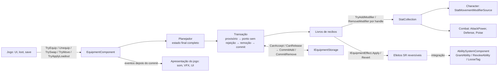

# M7 — Equipment · Especificação técnica

- **Status:** **v2 — aprovada para implementação** (auditoria da v2, 2026-10-14; implementação das seis entregas
  autorizada; ADRs 0033–0037 **aceitas**; precisões da auditoria da v2 incorporadas em §7.4 e §7.7) ·
  **Data:** 2026-10-14
- **Histórico:** v1 (proposta, WOR `e8f7786`) → v2 (transação em sete etapas com aplicação provisória e remoção do
  antigo só depois do ponto sem rejeição; contrato estrito de `IEquipmentEffect`; resolução de itens e contrato
  transacional do armazenamento; regras do `Rebuild` e da reativação; uso no Whiskers of Rage atualizado). Registro em
  §25.
- **Unity:** 6000.6.5f1 · **Package:** `com.ramirestechgames.equipment` (L5, `RamiresTechGames.Equipment`, define
  `RAMIRESTECHGAMES_EQUIPMENT`)
- **Dependências (grafo, sem mudança):** hard `core`, `stats`; opcional `abilities` (ADR-0002), exatamente como em
  `dependency-graph.json`. **Character e Combat não entram no grafo do Equipment** (§12.3–12.4).
- **Base contratual (APIs reais conferidas):** Core 0.4.0, Stats 0.1.1, Abilities 0.1.0 (candidatas, sem tags);
  Character 0.2.0 e Combat 0.1.0 só como consumidores do Stats. **Nenhuma API pública de package existente é
  alterada**; o que dependeria de mudança em outro package está na §19.2, com a alternativa adotada.
- **Fora do package:** itens, armas, armaduras, conjuntos, Jutsus e Técnicas de um jogo — no Whiskers of Rage são
  **assets e glue do jogo** (§18). Nenhum nome de jogo em código, assets ou samples.

---

## 1. Objetivo e escopo

Um **sistema genérico e data-driven para equipar itens em slots** de um ator e aplicar suas contribuições —
modificadores de atributos, habilidades e passivas concedidas, tags e efeitos customizados reversíveis — com
**reversibilidade exata**: desequipar remove somente o que aquele item contribuiu, sem tocar em modificadores,
concessões ou tags de outras fontes; e **atomicidade**: uma operação acontece inteira ou não muda nada.

### 1.1 Escopo do M7 (fechado)

| Obrigatório no M7 | Adiado (fora do M7) |
|---|---|
| Definições: slot, layout de slots, equipamento, conjunto, loadout | Loot, geração de itens, raridade, afixos aleatórios (o jogo cria as instâncias) |
| `EquipmentItem` (instância com identidade, nível e modificadores próprios) | Economia, loja, crafting, durabilidade, reparo |
| `EquipmentComponent`: slots, equipar, desequipar, trocar, mover, loadouts, habilitar/desabilitar contribuições | Inventário completo (grade, peso, empilhamento, filtros) e UI de inventário |
| Restrições: categoria do slot, ocupação de vários slots, unicidade, requisitos (SR) no ato de equipar | Reavaliação contínua de requisitos (D8) |
| **Livro de contribuições** com recibos e reversão por handle (normativo, §8) | Persistência em disco (o package exporta o estado; o jogo serializa) |
| **Transação em sete etapas** com aplicação provisória e ponto sem rejeição (normativo, §7) | Troca dinâmica de moveset/combo do Combat (§19.2) |
| Modificadores do Stats por item, por nível e por instância; ressincronização no `Rebuild` | Armadura de combate concedida por equipamento (`GrantArmor` adiado no M5) |
| Bônus de conjunto por limiar de peças (definições distintas, cumulativos) | Rede/rollback (R14) |
| `IEquipmentStorage` transacional e `EquipmentStash` mínimo | Integration assemblies com Character, Combat, HFSM ou AI |
| Integração Abilities: habilidades ativas, passivas, tags possuídas, requisitos por tags | Editor gráfico (não há grafo no domínio) |
| Ferramentas: inspectors, Equipment Debugger, validators; samples Equipment Basics e Equipment Abilities | |

---

## 2. Conceitos

| Termo | Definição |
|---|---|
| **Definição de equipamento** | `EquipmentDefinition` (SO, imutável): categoria, ocupação, modificadores por nível, efeitos (SR), conjunto, requisitos. |
| **Item** | `EquipmentItem`: instância de runtime de uma definição, com `ItemId`, nível e modificadores próprios. Está em **no máximo um lugar** (um slot de um componente, um armazenamento ou solto). |
| **Slot** | Posição de um ator definida por `EquipmentSlotDefinition`; o layout lista os slots e quantidades (ex.: "anel × 2"). |
| **Ocupação** | Slots que um item equipado ocupa: o slot principal e, opcionalmente, outros (ex.: arma de duas mãos bloqueia a mão secundária). |
| **Contribuição** | O que um item (ou limiar de conjunto) aplica ao ator: modificador de stat, concessão de habilidade, tag possuída, efeito customizado reversível. |
| **Recibo** | Registro de uma contribuição aplicada, com o handle que a reverte. |
| **Livro** | Recibos de um item equipado (ou de um limiar de conjunto ativo). |
| **Plano** | Estado final calculado de uma transação: slots, locais dos itens, movimentos de armazenamento, limiares de conjunto (§7.2). |
| **Contribuição provisória** | Contribuição nova aplicada durante a transação, antes do ponto sem rejeição; desfeita se a transação falhar. |
| **Ponto sem rejeição** | Momento da transação a partir do qual nenhuma operação pode recusá-la; só então o antigo é removido (§7.3). |
| **Conjunto** | `EquipmentSetDefinition`: definições distintas equipadas e habilitadas somam peças; limiares cumulativos. |
| **Loadout** | Configuração slot → item: asset (`EquipmentLoadoutDefinition`) ou estado capturado (`EquipmentLoadoutState`). |
| **Armazenamento** | Onde ficam itens não equipados: contrato `IEquipmentStorage`; implementação mínima `EquipmentStash`. |

---

## 3. Arquitetura

### 3.1 Assemblies

| Assembly | Conteúdo | Referências |
|---|---|---|
| `RamiresTechGames.Equipment` | Domínio (puro): definições, `EquipmentItem`, layout expandido, planejador, transação, livro, conjuntos, requisitos e efeitos incluídos; componentes `EquipmentComponent` e `EquipmentStash` | Core, Stats |
| `RamiresTechGames.Equipment.Editor` | Inspectors, Equipment Debugger, validators de cena, menus | Equipment, Core.Editor |
| `RamiresTechGames.Equipment.Integration.Abilities` | `GrantAbilityEffect`, `GrantPassiveAbilityEffect`, `GrantOwnedTagsEffect`, `OwnedTagsRequirement` | Equipment, Abilities (define `RAMIRESTECHGAMES_ABILITIES`) |
| Testes | `Tests.Editor`, `Tests.Runtime`, `Tests.Runtime.Integration` (Abilities) e fixtures de contrato | — |

### 3.2 Camadas e responsabilidades



- O **domínio é puro**: planejador, transação, livros e regras recebem coleção do Stats, armazenamentos e alvos dos
  efeitos; não leem a cena.
- O `EquipmentComponent` integra: resolve `StatsComponent` (e, pela integração, o `AbilitySystemComponent`) no mesmo
  GameObject, aplica o loadout inicial, acompanha `StatsComponent.Rebuilt` e expõe API e eventos.
- **Sem tick e sem banda** (ADR-0034): nada roda por frame; tudo acontece dentro das chamadas da API.

### 3.3 Por que livro de recibos e plano completo

O Stats garante que remover todos os modificadores de uma fonte iguala a coleção que nunca os recebeu (Stats, garantia
2), com soma em ordem canônica (operação, prioridade, valor) — independente da ordem de inserção. O Abilities conta
tags e concessões por fonte (garantias 8 e 22). Falta **um dono** que saiba quais handles cada item criou em cada
sistema e os reverta (ADR-0033), e **um plano** que descubra todas as operações que podem recusar a transação
**antes** de qualquer remoção irreversível (ADR-0034): revogar uma concessão encerra a execução e descarta cooldown e
cargas, então o antigo só sai quando nada mais pode falhar.

---

## 4. Definições (ScriptableObjects, imutáveis em runtime)

Todas implementam `IValidatable`, têm `StableId` (GUID do asset, mesmo mecanismo das definições do Stats) e menus
pelas constantes de `EquipmentPackageInfo`.

### 4.1 `EquipmentSlotDefinition`
| Campo | Tipo | Descrição |
|---|---|---|
| `DisplayName` | string | Nome para ferramentas e UI do jogo. |
| `AcceptedCategories` | `GameplayTagSet` | Categorias aceitas (consulta hierárquica do Core). Vazio = qualquer item. |
| `RejectedCategories` | `GameplayTagSet` | Categorias recusadas (vence `AcceptedCategories`). |

### 4.2 `EquipmentSlotLayoutDefinition`
Entradas ordenadas (`Slot`, `Count`): "anel × 2" gera `Anel[0]`, `Anel[1]`. Herança opcional (`ParentLayout`). O
índice no layout expandido é a **ordem total** de planos, recibos, eventos e ferramentas. Slots repetidos servem a
qualquer jogo (anéis, bolsos, acessórios).

### 4.3 `EquipmentDefinition`
| Campo | Tipo | Descrição |
|---|---|---|
| `Category` | `GameplayTag` | Categoria do item. |
| `Tags` | `GameplayTagSet` | Tags descritivas (consultas do jogo). |
| `AlsoOccupies` | lista de `EquipmentSlotDefinition` | Slots adicionais ocupados enquanto equipado (§6.2). |
| `UniqueGroup` / `UniqueLimit` | `GameplayTag` / int | No máximo `UniqueLimit` itens equipados do grupo. 0 = sem limite. |
| `MaxLevel` | int | Nível máximo da instância (≥ 1). |
| `Modifiers` | lista de `EquipmentModifierEntry` | Stat, operação (`Flat`/`Additive`/`Multiplicative`), valor e curva por nível opcional. |
| `Effects` | lista SR de `IEquipmentEffect` | Contribuições reversíveis não-Stats (§8.4). |
| `Requirements` | lista SR de `IEquipRequirement` | Avaliadas ao equipar (§6.4). |
| `Set` | `EquipmentSetDefinition` | Conjunto (opcional). |

### 4.4 `EquipmentSetDefinition`
Limiares ordenados (`Pieces`, `Modifiers`, `Effects`), **cumulativos** (D12): com 4 peças, os limiares de 2 e 4 estão
ativos. Peças = **definições distintas** equipadas e habilitadas (D11).

### 4.5 `EquipmentLoadoutDefinition`
Entradas (`SlotIndex`, `Equipment`, `Level`) para um layout; loadout inicial e predefinidos. Itens de um asset são
**criados** pelo componente (ids de runtime determinísticos, §5.2).

---

## 5. Instâncias, identidade, localização e handles

### 5.1 `EquipmentItem`
Classe pura: `Definition`, `ItemId`, `Level`, `InstanceModifiers` (somente leitura após criação), `Location`. Criação
por `EquipmentItem.Create(definition, level, itemId, instanceModifiers)`; o package não sorteia nada. Cada item é a
**fonte** (`IModifierSource`) dos próprios modificadores e a `source` das próprias concessões, por referência.

### 5.2 Identidade
`ItemId` (`ulong` ≠ 0), fornecido pelo jogo. Itens criados de um loadout-asset recebem ids de runtime do componente
(faixa reservada, sequência determinística por índice de slot). A identidade **nunca muda** com movimentações; o
package nunca recria uma instância existente.

### 5.3 Localização (normativo)
`ItemLocation` = `Detached` | `Slot(componente, índice)` | `Storage(armazenamento)`. Regras:
- só o Equipment muda a localização, e só no commit de uma transação (etapa 6 da §7.2);
- um item em `Slot` de um componente não pode ser usado por outro componente (`ItemNotAvailable`) — não há fontes
  compartilhadas entre atores;
- um item em `Storage` só entra numa transação se o armazenamento estiver entre as **fontes autorizadas** da chamada;
- `Detached`: item solto, administrado pelo jogo; pode ser equipado diretamente.

### 5.4 Handles
`EquippedItemHandle` = (dono, índice do slot principal, geração). Handles inválidos, antigos ou estrangeiros não agem.
Recibos guardam handles de outros packages; um handle que outro package já não reconhece é tratado na §8.6.

---

## 6. Slots, ocupação e restrições

### 6.1 Aceitação
`Category` casa (hierarquicamente) com `AcceptedCategories` (ou ela está vazia) e não casa com `RejectedCategories`.

### 6.2 Ocupação de vários slots
`AlsoOccupies` é resolvido **no plano** como a primeira instância livre de cada definição **no estado final**. Se os
slots a bloquear estão ocupados por itens que permanecem no plano, a política da chamada decide: `Fail` (padrão,
`SlotsBlocked`) ou `DisplaceToStorage` (os ocupantes saem para o destino da chamada, entram no plano como itens que
saem e passam pelas mesmas regras de capacidade e reversão).

### 6.3 Unicidade
No estado final, no máximo `UniqueLimit` itens do grupo. Trocas no mesmo slot contam o item que sai como saído.

### 6.4 Requisitos (`IEquipRequirement`, SR)
`bool IsSatisfied(in EquipRequirementContext context, out EquipFailureDetail detail)` + `Validate`. Puros, sem
alocação, avaliados **uma vez, na validação**, contra o estado do ator **antes da transação** (D8 aprovada).
Consequência documentada: numa troca, um requisito pode ter sido satisfeito por contribuições do item que sai (R54).
Incluídos: `StatRequirement`, `AllRequirements`, `AnyRequirement`; na integração, `OwnedTagsRequirement`.

---

## 7. Transações (normativo, ADR-0034)

### 7.1 Operações
| Operação | Efeito |
|---|---|
| `TryEquip(item, slotIndex, options)` | Equipa um item (`Detached` ou em armazenamento autorizado) |
| `Unequip(handle, destination)` / `TryUnequip` | Reverte contribuições, libera slots, entrega o item ao destino (`null` = `Detached`) |
| `TrySwap(handle, item, options)` | Troca o item de um slot por outro |
| `TryMove(handle, slotIndex)` | Move um item equipado para outro slot do mesmo componente **sem reaplicar contribuições** (contribuições não dependem do slot) |
| `TryApplyLoadout(source, options)` | Aplica um loadout (asset ou estado) com `ReplaceAll` ou `FillEmpty` |
| `TrySetContributionsEnabled(handle, enabled)` | Reverte/reaplica as contribuições sem desequipar |

`options`: fontes de armazenamento autorizadas, destino de saída, `BlockedSlotPolicy`, `MissingStatPolicy`.
Resultado `EquipResult`: `Succeeded`, `Reason` (`EquipFailureReason`), `Detail`, `Handle`, `SkippedEntries` (só
`FillEmpty`), `ContractViolations` (§7.4). Motivos: `InvalidItem`, `ItemNotFound`, `ItemNotAvailable`,
`DuplicateItemId`, `DefinitionMismatch`, `SlotNotFound`, `SlotRejectsCategory`, `SlotsBlocked`, `UniqueLimit`,
`RequirementNotMet`, `LevelOutOfRange`, `MissingStat`, `LedgerFull`, `StorageRejected`, `StorageFull`,
`ContributionFailed`, `Reentrant`, `ComponentInactive`.

### 7.2 Etapas (ordem normativa)
1. **Planejar** o estado final completo: itens resolvidos (§11.2), slot principal e ocupados de cada item, itens que
   entram, saem e permanecem, movimentos de armazenamento (para onde cada item que sai vai, de onde cada item que entra
   sai), contagem de peças por conjunto e **limiares que serão ativados e desativados**. Nenhum efeito colateral.
2. **Validar** sobre o plano, sem efeitos colaterais: categorias, ocupação, unicidade, níveis, requisitos, stats
   presentes (`MissingStatPolicy`), capacidade dos livros, e armazenamento (`CanRelease` de cada item que sai de um
   armazenamento, `CanAccept` e capacidade líquida de cada destino, contando as saídas do mesmo armazenamento no
   plano). Falha → `EquipFailed`, nada mais acontece.
3. **Aplicar o provisório**, com o lote do Stats aberto (`BeginBatch`): primeiro os **efeitos** de todos os itens que
   entram e de todos os limiares que serão ativados (ordem: índice de slot, depois limiares por conjunto e peças;
   dentro de cada um, ordem da lista); depois os **modificadores** dos mesmos (já validados na etapa 2). Cada
   contribuição gera seu recibo antes da próxima.
4. **Desfazer o provisório se algo recusar**: reverte, em ordem inversa, só os recibos provisórios; fecha o lote (o
   Stats não notifica: valores finais iguais aos iniciais, garantia 7); `EquipFailed(ContributionFailed)` com o
   índice/efeito que recusou. Itens que saíam e limiares que seriam desativados **nunca foram tocados**.
5. **Ponto sem rejeição** → **remover o antigo**: reverte os livros dos itens que saem e dos limiares que serão
   desativados (ordem inversa de aplicação). Só operações infalíveis por contrato (§7.4).
6. **Consolidar**: slots e ocupações, localização dos itens, gerações de handles, livros provisórios promovidos,
   limiares ativos; armazenamento por `CommitRemove`/`CommitAdd` (infalíveis por contrato).
7. **Fechar o lote do Stats** (notificações do Stats ao mundo) e **publicar os eventos** do Equipment (§7.6).

### 7.3 Consequências
- **I4 sem reconceder**: o antigo só é tocado na etapa 5, quando nenhuma operação restante pode recusar a transação;
  falhas de requisito, capacidade, armazenamento, efeito ou limiar de conjunto deixam intactos identidade, execução em
  andamento, cooldown e cargas das concessões do item antigo.
- **Custo aceito**: durante a etapa 3, novo e antigo coexistem — capacidades de concessões (padrão 16, configurável) e
  tags soltas (16 fixas) precisam comportar os dois (R46).
- `TryMove` e itens que **permanecem** no plano (mesmo slot ou outro slot do mesmo componente) nunca são revertidos nem
  reaplicados.

### 7.4 Operações infalíveis depois da validação (contrato)
| Operação | Garantia exigida | Violação inesperada |
|---|---|---|
| `StatCollection.RemoveModifier(handle)` | Remove o modificador do recibo | `false` (handle já inválido): recibo descartado, `RevertTargetMissingCount`, aviso uma vez |
| `RevokeAbility(handle)`, `RemoveLooseTag(handle)` | Revogam a concessão/tag do recibo | `false`: idem |
| `IEquipmentEffect.Revert` | Desfaz exatamente o `Apply` (§8.4) | Exceção: registrada (`LogException` uma vez por tipo), `EffectRevertExceptionCount`, recibo descartado, transação continua |
| `IEquipmentStorage.CommitRemove/CommitAdd` | Executam o que `CanRelease`/`CanAccept` aprovaram | Exceção ou pós-condição falsa (`Contains`): item fica `Detached`, `StorageViolationCount`, `LogError`, listado em `ContractViolations` |
| Livros, slots, handles | Internos | — |
| Listeners (Stats, eventos do Equipment) | Isolados | Exceção registrada; demais listeners recebem |

Uma transação que chegou à etapa 5 **é consolidada** mesmo com violações (não há como voltar sem reconceder).
**Precisão da auditoria da v2:** o resultado distingue sucesso íntegro (`Succeeded = true`, `IsClean = true`,
`ContractViolations = 0`) de sucesso com violações (`Succeeded = true`, `IsClean = false`, `ContractViolations > 0`);
o componente expõe `ViolationCount`, os itens `Detached` por violação (`GetDetachedByViolation`) e o Debugger mostra
cada violação com transação, operação e item. Violações nunca aparecem como sucesso normal.

### 7.5 O que não é prometido
Rollback perfeito de **callbacks externos irreversíveis** não existe: uma passiva concedida provisoriamente e revogada
na etapa 4 deixa, no Abilities, o descarte do efeito pendente (`EffectBlocked` com `SourceEnded` na A2 seguinte) e
gerações de vaga avançadas; efeitos customizados que violam o contrato (§8.4) podem deixar resíduo. O estado do
Equipment, os stats, as concessões e as tags voltam ao anterior; esses resíduos são documentados (R52).

### 7.6 Eventos e apresentação
- **Sucesso**: depois do commit e do fechamento do lote, em ordem fixa: `Unequipped` (itens que saíram, por índice) →
  `Moved` → `Equipped` (itens que entraram) → `SetBonusChanged` → `ContributionsStateChanged` → `Changed` (um por
  transação).
- **Falha**: **somente** `EquipFailed`. Nenhum outro evento do Equipment.
- **Apresentação** (som, VFX, notificações) acontece **só** em listeners desses eventos — nunca em `Apply`/`Revert`.
- O Abilities enfileira seus próprios eventos e os despacha na A2 seguinte (tags com diferença por passo): concessões e
  revogações de uma transação não chamam listeners do Abilities durante a transação.

### 7.7 Reentrância
Da etapa 1 até o fim da entrega de eventos, o Equipment está **ocupado**: qualquer transação em **qualquer**
`EquipmentComponent` aberta nesse intervalo (de efeitos, listeners do Stats ou do Equipment) retorna `Reentrant`.
`Enqueue(operation)` registra a operação numa fila FIFO executada depois da transação externa terminar (cada uma
com resultado próprio, entregue por callback). Leituras (`GetEquipped`, livros) são permitidas.

**Precisão da auditoria da v2 (Enqueue e rollback):**
- operações enfileiradas **durante as etapas 1–4** de uma transação que acaba recusada (ex.: por um efeito provisório)
  são **descartadas** junto com o provisório — recebem resultado `Discarded` no callback e nunca executam;
- operações enfileiradas nas etapas 5–7 de uma transação consolidada, ou por listeners de `EquipFailed`/eventos de
  sucesso, executam em FIFO depois da transação (recuperação depois de uma falha é permitida);
- cada operação da fila é uma transação própria, sujeita à mesma reentrância;
- **proteção contra ciclos**: no máximo `MaxQueuedPerDrain` (padrão 64) operações executadas por drenagem; o excedente
  é descartado com `QueueOverflow`, contado e registrado (ex.: listener que reenfileira a mesma troca a cada falha).

### 7.8 Recursos (Stats)
Mudanças de máximo seguem a `ResourceMaxChangePolicy` do recurso, aplicada **uma vez por lote** pelo Stats; o Equipment
não restaura `Current` (aprovado, R45).

### 7.9 Habilitar/desabilitar, inicialização e reativação
- `TrySetContributionsEnabled(handle, false)`: transação cujo plano remove as contribuições do item (e desativa
  limiares que dependiam dele); infalível depois da validação. `true`: transação com aplicação provisória; falha deixa
  o item desabilitado e retorna o motivo.
- `Start`: o loadout inicial é **uma** transação `ReplaceAll` a partir do vazio; falha → componente vazio,
  `EquipFailed` com motivo e aviso no console (o validator de cena acusa o pior caso antes).
- `OnDisable`: desabilita todos (infalível). `OnEnable`: reaplica **item a item** em ordem de índice, cada um como uma
  transação de habilitação; um item que não puder ser reaplicado fica equipado e desabilitado
  (`DisabledReason.ReapplyFailed`, `ContributionsStateChanged`); depois, os limiares são recalculados numa transação
  própria (limiar que falha fica `Suspended` e é tentado de novo na próxima transação bem-sucedida do componente).
- `OnDestroy`: reverte todos os livros (infalível; alvos já destruídos contam em `RevertTargetMissingCount`).

---

## 8. Contribuições e reversibilidade (normativo, ADR-0033)

### 8.1 Invariantes
- **I1 — Isolamento:** depois de desequipar ou desabilitar um item, todo stat tem valor **bit a bit** igual ao de uma
  coleção **real** do Stats que recebeu as mesmas outras contribuições e nunca recebeu as do item, em qualquer ordem
  de operações (a soma do Stats 0.1.1 é canônica por operação, prioridade e valor).
- **I2 — Sem efeitos sobre outras fontes:** o Equipment remove **somente por handle** de recibos próprios. Nunca chama
  `RemoveModifiersFromSource`, `RevokeAbilitiesFromSource` ou remoções por tag.
- **I3 — Livro exato:** cada contribuição aplicada tem exatamente um recibo; cada recibo é revertido no máximo uma vez;
  o livro de um item fora de um slot ou desabilitado está vazio; recibos dormentes (§8.5) são marcados.
- **I4 — Atomicidade:** uma transação que falha antes do ponto sem rejeição deixa slots, localizações,
  armazenamentos, livros, stats, concessões e tags iguais ao estado anterior; contribuições do item antigo nunca são
  reconcedidas (§7.3).
- **I5 — Rebuild:** depois de `StatsComponent.Rebuild`, os modificadores de itens habilitados e limiares ativos estão
  na coleção nova, sem duplicação, com handles substituídos nos recibos (§8.5).

### 8.2 Recibos
`EquipmentReceipt` (struct): tipo (`StatModifier`, `Effect`), índice da contribuição, estado (`Active`, `Dormant`),
handle do Stats ou `EquipmentEffectToken` (`int` + objeto opaco, sem alocação). Livros de **capacidade fixa**:
`MaxContributionsPerItem` (padrão 32) por item e por limiar; definições que excedem são erro do validator; modificadores
de instância contam no plano (`LedgerFull` na validação). **Um efeito = um recibo**: um efeito que gerencia várias
coisas guarda o que precisa no próprio token.

### 8.3 Modificadores do Stats
Cada `EquipmentModifierEntry` (definição → nível → instância): `TryAddModifier(stat, new StatModifier(op, valor,
source: item))` → recibo. A presença do stat e a validade do valor são checadas na validação (`MissingStatPolicy`:
`Skip` = contribuição não aplicada e contada, ou `Fail` = `MissingStat`). Reversão: `RemoveModifier(handle)`.

### 8.4 Efeitos (`IEquipmentEffect`, SR — extension point, contrato estrito)
```
bool Apply(in EquipmentEffectContext context, out EquipmentEffectToken token);
void Revert(in EquipmentEffectContext context, in EquipmentEffectToken token);
void Validate(ValidationReport report, UnityEngine.Object owner, string label);
```
1. **Somente contribuições reversíveis**: mudanças de estado do ator que `Revert` desfaz exatamente pelo token.
   Proibido em `Apply`/`Revert`: som, VFX, UI, notificações, logs de gameplay, gravação em disco — isso vai em
   listeners dos eventos de sucesso (§7.6).
2. **Tudo-ou-nada**: `Apply` que retorna `false` não pode deixar resíduo. Retornar `false` depois de aplicar parte é
   **violação de contrato**, detectável pelo kit de contrato dos testes (§17.1); em runtime não é detectável em geral.
3. **Exceção em `Apply`**: tratada como recusa (`ContributionFailed`, detalhe `EffectException`), registrada uma vez por
   tipo; a transação desfaz os recibos anteriores; o resíduo do efeito que lançou não é desfeito (violação, R51).
4. **`Revert` é infalível por contrato**: exceção registrada e contada, recibo descartado (§7.4).
5. **Reentrância**: efeitos não abrem transações do Equipment (retornam `Reentrant`, §7.7) nem chamam
   `BeginBatch`/`Rebuild` do Stats; podem ler o estado do ator e usar `Enqueue` somente para trabalho pós-transação.
6. **Stats**: efeitos que alteram stats devem usar handles próprios (no token); rodam dentro do lote aberto pela
   transação (sem `StatChanged` até a etapa 7).
7. **Abilities**: chamadas ao ASC dentro de `Apply`/`Revert` seguem as regras de tempo do Abilities (passivas na A2
   seguinte; eventos do ASC despachados na A2).
8. Sem alocação em regime; `IStatsRebuildAware` opcional para efeitos que guardam handles do Stats.

### 8.5 `StatsComponent.Rebuild`
No `Rebuilt` (o componente se inscreve em `OnEnable` e sai em `OnDisable`): o componente abre um lote na coleção nova
e, em ordem de índice e depois limiares, reaplica cada recibo de modificador **ativo ou dormente** dos itens habilitados
e limiares ativos:
- stat presente → `TryAddModifier` e **substitui o handle** no recibo (o handle antigo pertencia à coleção descartada e
  nunca é usado);
- stat ausente na coleção nova → recibo `Dormant` (contribuição suspensa, `DormantModifierCount`, aviso uma vez);
  dormentes são tentados de novo no próximo `Rebuild`; reverter um dormente é no-op;
- efeitos com `IStatsRebuildAware` recebem a coleção nova; os demais não são tocados.
O Abilities reaplica sozinho os modificadores dos seus efeitos ativos (garantia 11): o Equipment não toca neles. A soma
canônica do Stats garante o mesmo valor final em qualquer ordem de reaplicação entre os dois packages.

### 8.6 Handles obsoletos e fontes compartilhadas
- Recibo cujo handle o package dono já não reconhece (alvo destruído, coleção trocada fora do `Rebuilt`) → reversão
  retorna `false` → recibo descartado e contado; nunca há remoção por fonte para "compensar".
- Um item não pode estar em dois atores (§5.3). Código do jogo que use um item como `IModifierSource` dos próprios
  modificadores viola o contrato: o Equipment não os remove (I2); em Development, depois de reverter um item, o
  componente confere `GetAllModifiers` e avisa se ainda houver modificadores com aquela fonte
  (`ForeignSourceUseCount`).

### 8.7 Abilities (integração, ADR-0035)
| Efeito | Apply | Revert | Observações |
|---|---|---|---|
| `GrantAbilityEffect` | `GrantAbility(ability, nível, inputTag, source: item)` → `AbilityHandle` (inválido = recusa) | `RevokeAbility(handle)` | Execução em andamento termina com `Revoked`, sem reembolso; cooldown/cargas são da concessão (R44) |
| `GrantPassiveAbilityEffect` | concessão de habilidade `Passive` | `RevokeAbility(handle)` | **Forma suportada de "efeito enquanto equipado"** (passivas entram na A2 seguinte e saem na revogação) |
| `GrantOwnedTagsEffect` | `AddLooseTag` por tag; recusa se alguma vier inválida (desfaz as anteriores do mesmo efeito antes de retornar `false`) | `RemoveLooseTag` por handle | Tags somam por fonte |

Sem `ApplyEffect` direto (retorna só `bool`, sem handle). Para muitas tags, passiva cujo efeito tem `GrantedTags` (não
usa tags soltas).

---

## 9. Conjuntos

`EquipmentSetTracker` conta, no **plano**, as definições distintas equipadas e habilitadas por conjunto. Limiares que
passam a valer são aplicados **provisoriamente na etapa 3** (falha desfaz a transação inteira, sem tocar no antigo);
limiares que deixam de valer são revertidos na **etapa 5**. Livro próprio por limiar (fonte = objeto do limiar no
ator). Limiares cumulativos (D12). Um limiar `Suspended` (§7.9) é tentado de novo na próxima transação bem-sucedida.

---

## 10. Armazenamento (ADR-0036)

### 10.1 Contrato `IEquipmentStorage` (transacional)
| Membro | Fase | Garantia |
|---|---|---|
| `bool TryFind(ulong itemId, out EquipmentItem item)`, `bool Contains(EquipmentItem item)`, `int Count`, `int Capacity` | leitura | sem efeitos |
| `bool CanRelease(EquipmentItem item)` | validação | sem efeitos; `true` ⇒ `CommitRemove` deste item nesta transação terá sucesso |
| `bool CanAccept(EquipmentItem item)` | validação | sem efeitos; `true` ⇒ `CommitAdd` terá sucesso se a capacidade líquida do plano couber |
| `void CommitRemove(EquipmentItem item)`, `void CommitAdd(EquipmentItem item)` | commit (etapa 6) | **infalíveis** para o que foi validado; sem eventos do armazenamento antes do commit da transação |

Capacidade líquida: `Count − saídas do plano + entradas do plano ≤ Capacity`. O planejador chama `CommitRemove` de
todas as saídas antes de qualquer `CommitAdd` do mesmo armazenamento. Violação → §7.4.

### 10.2 `EquipmentStash`
MB mínimo: lista ordenada com capacidade, ids únicos, `TryFind` por id, eventos `Added`/`Removed` emitidos depois do
commit da transação. Serve a samples e jogos simples. Inventário completo continua fora (D9 aprovada).

### 10.3 Falhas de armazenamento
- **Antes/na validação**: `CanRelease`/`CanAccept` falsos → `StorageRejected`; capacidade líquida → `StorageFull`;
  nada aplicado.
- **Depois da validação**: só por violação de contrato → item `Detached`, transação consolidada, violação reportada.

---

## 11. Loadouts

### 11.1 Asset
`EquipmentLoadoutDefinition`: loadout inicial e predefinidos. Ao aplicar, cria itens só para entradas cujo slot não
tenha já um item da mesma definição e nível que possa permanecer (sem recriar instâncias existentes).

### 11.2 Estado (`EquipmentLoadoutState`) e resolução de itens
`CaptureLoadout()` exporta, por slot principal: `ItemId`, `StableId` da definição, nível, modificadores de instância,
habilitado. `TryApplyLoadout(state, options)` **nunca cria itens**: resolve cada `ItemId` nesta ordem —
1. itens equipados **neste** componente;
2. armazenamentos **autorizados** na chamada, na ordem dada;
3. não encontrado → `ItemNotFound`; encontrado em outro componente ou armazenamento não autorizado →
   `ItemNotAvailable`.

Regras: o mesmo `ItemId` duas vezes no estado → `DuplicateItemId`; definição do item ≠ `StableId` do estado →
`DefinitionMismatch`; nível e modificadores do **item** valem (os do estado são informativos). Para carregar um save,
o jogo recria as instâncias, coloca-as num armazenamento e aplica o estado.

### 11.3 Políticas
- **`ReplaceAll`**: o estado final é exatamente o do loadout; itens equipados que não estão nele saem para o destino
  (capacidade validada); itens que estão no mesmo slot **permanecem** (não são revertidos nem reaplicados — preservam
  execuções, cooldowns e cargas); itens do mesmo componente em outro slot são **movidos**.
- **`FillEmpty`**: só slots vazios **no estado atual** e não bloqueados por ocupação; entradas para slots ocupados são
  ignoradas e contadas em `SkippedEntries`; nada sai.
- **Ocupação múltipla**: resolvida no plano final (§6.2); com `Fail`, um item de duas mãos cujo slot bloqueado esteja
  ocupado por item que permanece recusa o loadout; com `DisplaceToStorage`, o ocupante sai para o destino.
- Captura seguida de aplicação no mesmo ator é **no-op** (todos permanecem).

---

## 12. Integrações

### 12.1 Stats (hard)
Modificadores, requisitos por stat, lote e `Rebuild`. Nenhuma API nova.

### 12.2 Abilities (opcional)
§8.7 e `OwnedTagsRequirement`. Nenhuma API nova.

### 12.3 Character (sem integration assembly)
Movimento pelo `StatMovementModifierSource` (stats); habilidades de movimento concedidas usam a integração Abilities ↔
Character existente.

### 12.4 Combat (sem integration assembly)
Ataque, defesa, poise e guarda por stats; golpes de arma = habilidades concedidas com `PerformAttackAction`. Troca de
moveset/combo do `CombatController` fora do M7 (aprovado; §19.2).

### 12.5 HFSM e AI
Nenhuma integração.

---

## 13. Tempo, determinismo e desempenho

- **Sem tick** (ADR-0034). Modificadores valem na hora; passivas na A2 seguinte; revogação encerra execução na chamada.
  Para o mesmo resultado em qualquer frame rate, o jogo chama a API no passo fixo; em `Update` (UI) é válido, com efeito
  visível no passo seguinte.
- **Inicialização**: `Awake` (layout e livros pré-alocados), `OnEnable` (resolve Stats, inscreve `Rebuilt`, reaplica
  item a item), `Start` (loadout inicial). Sem `[DefaultExecutionOrder]`.
- **Determinismo**: sem aleatoriedade; mesma sequência de chamadas ⇒ mesmos planos, recibos, eventos e handles.
- **Zero GC em regime** para todas as transações com itens existentes (planos, listas de validação, livros e args
  pré-alocados). Fora do regime: criação de itens, primeira inicialização, `Rebuild`, ferramentas, caminhos de erro com
  log.

---

## 14. Ferramentas de autoria

| Ferramenta | Conteúdo |
|---|---|
| Inspector de `EquipmentDefinition` | Categoria e slots compatíveis, ocupação, modificadores com prévia por nível, efeitos/requisitos com o seletor SR do Core, conjunto |
| Inspectors de layout e loadout | Slots expandidos com índice; loadout em tabela com compatibilidade em tempo real |
| Inspector de `EquipmentComponent` (Play Mode) | Slots, itens, habilitado/motivo, livros (recibos, handle, estado `Active`/`Dormant`), limiares ativos/suspensos, botões de teste |
| **Equipment Debugger** | Atores, histórico das últimas 64 transações (plano, resultado, motivo, recibos provisórios/removidos, violações), contadores |
| Validators | Slot sem categorias, ids duplicados, item que nenhum slot aceita, modificador sem stat/valor inválido, SR vazio ou de tipo ausente, `AlsoOccupies` com o próprio slot, limiares fora de ordem/repetidos, loadout incompatível, contribuições acima da capacidade; na cena: componente sem `StatsComponent`, stats do loadout inicial ausentes, pior caso de concessões/tags acima das capacidades do ASC |

---

## 15. Samples

- **Equipment Basics** (Stats): layout com arma, mão secundária, armadura e 2 anéis; `EquipmentStash`; painel com stats e
  decomposição por fonte; arma de duas mãos bloqueando a mão secundária, anel único, conjunto 2/3 peças, requisito de
  stat, dois loadouts trocados por tecla (itens que permanecem não reaplicam), desabilitar/reabilitar.
- **Equipment Abilities** (Stats + Abilities): arma que concede golpe (ativa), amuleto com passiva, item com tag possuída,
  conjunto que concede passiva no limiar; prova visual de que desequipar não remove o buff de outra fonte e de que uma
  troca recusada preserva o cooldown da arma antiga.

Ambos com smoke tests versionados na Sandbox do host.

---

## 16. API pública (proposta)

| Tipo | Categoria | Descrição |
|---|---|---|
| `EquipmentSlotDefinition`, `EquipmentSlotLayoutDefinition`, `EquipmentDefinition`, `EquipmentSetDefinition`, `EquipmentLoadoutDefinition` | SO | §4 |
| `EquipmentModifierEntry`, `EquipmentSetThreshold`, `EquipmentLoadoutEntry` | serializable | Entradas |
| `EquipmentItem`, `ItemLocation` | classe / struct | §5 |
| `EquippedItemHandle`, `EquipResult` (`Succeeded`, `IsClean`, `ContractViolations`), `EquipFailureReason`, `EquipFailureDetail`, `EquipOptions`, `LoadoutPolicy`, `BlockedSlotPolicy`, `MissingStatPolicy`, `DisabledReason`, `ContractViolation` | structs/enums | §5–§7 |
| `EquipmentComponent` | MB | `Layout`, `Slots`, `GetEquipped`, `TryGetItem`, `TryEquip`, `Unequip`/`TryUnequip`, `TrySwap`, `TryMove`, `TryApplyLoadout`, `CaptureLoadout`, `TrySetContributionsEnabled`, `IsEnabled`, `Enqueue`, `GetReceipts`, `ActiveSetThresholds`, `IsBusy`; eventos `Equipped`, `Unequipped`, `Moved`, `EquipFailed`, `SetBonusChanged`, `ContributionsStateChanged`, `Changed`; contadores |
| `IEquipmentStorage`, `EquipmentStash` | interface / MB | §10 |
| `EquipmentLoadoutState` | dados | §11.2 (contrato versionado) |
| `IEquipmentEffect`, `EquipmentEffectContext`, `EquipmentEffectToken`, `IStatsRebuildAware` | extension point | §8.4 |
| `IEquipRequirement`, `EquipRequirementContext`, `StatRequirement`, `AllRequirements`, `AnyRequirement` | extension point / SR | §6.4 |
| `EquipmentReceipt`, `EquipmentReceiptKind`, `EquipmentReceiptState` | leitura | §8.2 |
| Integração: `GrantAbilityEffect`, `GrantPassiveAbilityEffect`, `GrantOwnedTagsEffect`, `OwnedTagsRequirement` | SR | §8.7 |

Toda API nasce `Experimental` 0.1.0.

---

## 17. Qualidade

### 17.1 Estratégia de testes (depois da implementação de cada entrega, sem TDD)

**Kit de falhas injetadas (fixtures):** efeito de teste configurável para recusar, lançar em `Apply`, lançar em
`Revert`, ou violar o tudo-ou-nada; armazenamento de teste que recusa em `CanAccept`/`CanRelease` ou viola o commit;
requisito de teste. Kit de contrato `EquipmentEffectContract` (aplicar → reverter → comparar o estado do ator) que o jogo
pode reutilizar nos próprios efeitos.

**Atomicidade (I4), por posição da falha:** para cada etapa e cada posição na lista (primeiro, meio, último efeito;
primeiro e último item de um loadout; limiar de conjunto), o estado completo — slots, localizações, armazenamentos,
livros, stats bit a bit, concessões (handles, execução em andamento, cooldown, cargas) e tags — é igual ao anterior.
Caso obrigatório: **troca em que o limiar de conjunto do item novo recusa depois de o item novo estar provisoriamente
aplicado** → item antigo preserva identidade, `AbilityHandle`, execução em andamento, cooldown e cargas.

**Reversibilidade por modelo de referência (I1–I3):** sequências pseudoaleatórias (≥ 500 operações, 3 sementes) de
equipar, desequipar, trocar, mover, loadouts, desabilitar, `Rebuild`, com outras fontes ativas (modificadores de script
e, na integração, efeitos e tags de outras fontes). Depois de cada operação: cada stat **bit a bit** igual ao de uma
`StatCollection` real reconstruída com as mesmas outras fontes e só os itens equipados/habilitados; modificadores de
outras fontes presentes por handle; livros iguais ao modelo. Repetido com ordem embaralhada.

**Rebuild e reativação (I5):** `Rebuild` com itens, limiares e efeitos ativos do Abilities; stat removido do set →
recibo dormente → restaurado num `Rebuild` seguinte; `OnDisable`/`OnEnable` com item cuja reaplicação falha
(desabilitado com motivo) e limiar suspenso; handles obsoletos contados; uso indevido de item como fonte detectado.

**Armazenamento e loadouts:** armazenamento cheio (capacidade líquida com saídas e entradas no mesmo plano), recusa
antes da validação, violação depois; arma de duas mãos com mão secundária ocupada (`Fail` e `DisplaceToStorage`);
loadout com itens parcialmente equipados (permanecem, movem, entram, saem); `ReplaceAll` e `FillEmpty`
(`SkippedEntries`); `ItemNotFound`, `ItemNotAvailable` (outro ator, armazenamento não autorizado), `DuplicateItemId`,
`DefinitionMismatch`; captura → aplicação é no-op e não recria instâncias.

**Eventos e reentrância:** só `EquipFailed` em falhas; ordem dos eventos no sucesso; nenhum `StatChanged` numa
transação desfeita; `Reentrant` de efeitos e listeners em qualquer componente; `Enqueue` FIFO.

**Integração (Abilities real):** concessão ativa revogada com execução em andamento; passiva na A2 seguinte e removida
na revogação, com o mesmo efeito de outra fonte intacto; tags com a mesma tag de outra fonte; capacidade esgotada →
rollback sem resíduo nos stats/concessões/tags (resíduo documentado na §7.5 conferido); zero GC com 50 atores.

**Sandbox do host:** velocidade do Character pelo stat de um item; dano do Combat com arma; golpe concedido executado
pela HFSM; smoke tests dos samples.

### 17.2 Critérios de aceite
| # | Critério |
|---|---|
| AC1 | Equipar/desequipar restaura **exatamente** os stats (I1) com coleção real, outras fontes ativas e qualquer ordem (modelo de referência). |
| AC2 | Concessões, passivas e tags do item são revogadas ao desequipar, só por handle; as de outras fontes, intactas (I2). |
| AC3 | Atomicidade (I4): falha injetada em cada etapa e posição deixa o estado idêntico; o item antigo nunca é reconcedido (identidade, execução, cooldown e cargas preservados), inclusive com falha em limiar de conjunto. |
| AC4 | Operações depois do ponto sem rejeição são infalíveis por contrato; violações injetadas são consolidadas e reportadas. |
| AC5 | Slots com categoria, ocupação múltipla, unicidade e requisitos cobertos por testes e validators. |
| AC6 | `StatsComponent.Rebuild` e reativação (I5): handles substituídos, dormentes, itens desabilitados com motivo, limiares suspensos. |
| AC7 | Conjuntos com definições distintas e limiares cumulativos aplicados provisoriamente e revertidos com as mesmas invariantes. |
| AC8 | Loadouts: resolução de ids sem duplicação, itens que permanecem não reaplicam, `ReplaceAll`/`FillEmpty`, armazenamento transacional; captura → aplicação é no-op. |
| AC9 | `IEquipmentEffect` com contrato estrito: falhas em posições diferentes, exceções em `Apply`/`Revert`, reentrância recusada, apresentação só após sucesso. |
| AC10 | Zero GC em regime; nenhum custo por frame. |
| AC11 | Ferramentas validadas (automação + validação manual do owner); caso comum só pelo Inspector. |
| AC12 | QG1–QG12; **QG12 com Core + Stats**; nenhum nome de jogo; nenhuma API de outro package alterada. |

### 17.3 Quality Gates
QG1–QG12 de `CLAUDE.md` do package; regressão completa do host; `check_dependencies`; clone limpo com submodules.

---

## 18. Whiskers of Rage — como o jogo usará o package (sem código no package)

A progressão atual do WOR usa **Jutsus, Técnicas e Equipamentos** (o GDD 2025 descrevia cartas; o jogo não usa mais
cartas). Tudo é asset/glue do jogo.

| Necessidade do jogo | Mecanismo |
|---|---|
| **Equipamentos**: armas, armaduras, acessórios | Itens nos slots do layout do protagonista; modificadores de stats; efeitos reversíveis |
| **Conjuntos** (ex.: peças de uma armadura especial) | `EquipmentSetDefinition` com limiares cumulativos que concedem passivas ou habilidades |
| **Armas** com golpes próprios | Concessões de habilidades com `PerformAttackAction`; moveset/combo do `CombatController` continua no prefab (troca dinâmica adiada) |
| **Jutsus** | **Abilities** (habilidades ativas do ator), não itens; um equipamento pode concedê-los quando o design pedir (`GrantAbilityEffect`) |
| **Técnicas** | Mecanismos **passivos do Abilities**; podem ser concedidas por itens quando aplicável (`GrantPassiveAbilityEffect`) |
| Itens obtidos durante a run | `EquipmentStash` da run ou armazenamento do jogo via `IEquipmentStorage` |
| Save de run e progresso | `CaptureLoadout` + serialização do jogo (ids e `StableId`) |

Slots repetidos continuam genéricos no package (anéis, acessórios ou o que outro jogo precisar); o WOR não usa cartas.

---

## 19. Impacto em packages existentes

### 19.1 Nenhuma alteração
Core, Stats, HFSM, Character, Combat, Abilities e AI não mudam; o grafo não muda (`status` de `equipment` passa de
`planned` para `in-progress` só na entrega 1).

### 19.2 Lacunas que dependem de mudança em package existente (fora do M7)
| Lacuna | Alternativa adotada no M7 | Mudança futura (ADR + minor do package dono) |
|---|---|---|
| Moveset/combo do `CombatController` somente leitura | Golpes de arma como habilidades concedidas | Combat: fonte de moveset trocável + `Equipment.Integration.Combat` (aresta opcional nova) |
| `ApplyEffect` do Abilities sem handle/fonte | Passivas concedidas | Abilities: aplicação com fonte e handle de remoção |
| Capacidade de concessões/tags sem consulta pública | Aplicação provisória detecta a recusa e desfaz | Abilities: consulta de vagas livres de concessão e de tags soltas (pré-checagem na validação) |
| Tags soltas fixas em 16 por ator | Validator do pior caso; `GrantedTags` em passivas | Abilities: capacidade de tags soltas configurável |
| Rollback de passiva provisória deixa `EffectBlocked(SourceEnded)` | Documentado (R52) | Abilities: cancelamento silencioso de concessão no mesmo passo |
| Tags do `CombatTarget` sem contagem por fonte | Tags possuídas do Abilities | Combat: tags de alvo com fonte |
| `GrantArmor` adiado | Armadura só pelas janelas do `AttackDefinition` | Abilities/Combat: armadura concedida |
| Leitura de stat sem as contribuições de uma fonte | Requisitos só no ato de equipar (D8) | Stats: consulta "valor sem a fonte X" |

---

## 20. Decisões

| # | Decisão | Situação |
|---|---|---|
| D1 | Grafo inalterado: hard core+stats, opcional abilities; sem integração com Character/Combat | Aprovada |
| D2 | Livro de recibos, reversão por handle, item como fonte (ADR-0033) | Aprovada |
| D3 | Transação em sete etapas: plano completo → validação → provisório → desfazer → ponto sem rejeição e remoção do antigo → commit → lote e eventos; operações infalíveis do commit; violações distintas do sucesso íntegro (`IsClean`) (ADR-0034) | Aprovada (refinada na v2 + precisão da auditoria da v2) |
| D4 | Sem tick e sem banda; API síncrona (ADR-0034) | Aprovada |
| D5 | Abilities só por concessões, passivas concedidas e tags soltas (ADR-0035) | Aprovada |
| D6 | Make-before-break **estrito**: todas as contribuições novas potencialmente falíveis (itens e limiares) aplicadas provisoriamente antes de qualquer remoção; itens que permanecem nunca são revertidos | Aprovada (refinada na v2) |
| D7 | Slots por definição e layout; ocupação múltipla resolvida no plano; unicidade (ADR-0036) | Aprovada |
| D8 | Requisitos só no ato de equipar | Aprovada |
| D9 | `IEquipmentStorage` (agora transacional) e `EquipmentStash` mínimo, sem inventário completo | Aprovada (contrato detalhado na v2) |
| D10 | Itens com identidade estável e localização única; `TryApplyLoadout(state)` resolve ids em equipados e armazenamentos autorizados, nunca recria instâncias; regras de ausência, duplicação, outro ator e definição divergente (ADR-0037) | Aprovada (refinada na v2) |
| D11 | Peças por definição distinta | Aprovada |
| D12 | Limiares cumulativos | Aprovada |
| D13 | `Current` de recursos segue a política do Stats | Aprovada |
| D14 | `OnDisable`/`OnEnable`/`OnDestroy` (reativação item a item na v2) | Aprovada (detalhada na v2) |
| D15 | Reentrância recusada em qualquer componente durante uma transação; `Enqueue` FIFO, descarte das operações enfileiradas por transações recusadas e limite por drenagem | Aprovada (precisão da auditoria da v2) |
| D16 | Sem editor gráfico | Aprovada |
| D17 | `IEquipmentEffect` com contrato estrito (só contribuições reversíveis, tudo-ou-nada, exceções, reentrância, apresentação só após sucesso) | Aprovada (nova na v2) |
| D18 | `TryMove`: mudar de slot no mesmo componente não reaplica contribuições (contribuições independem do slot) | Aprovada (nova na v2) |

---

## 21. ADRs (aceitas na auditoria da v2)

| # | Título |
|---|---|
| [0033](../adr/0033-equipment-contribution-ledger.md) | Livro de contribuições e reversibilidade exata do Equipment |
| [0034](../adr/0034-equipment-transactions-and-timing.md) | Transações atômicas do Equipment em sete etapas, sem tick |
| [0035](../adr/0035-equipment-abilities-through-grants.md) | Efeitos do Equipment sobre o Abilities somente por concessões e tags soltas |
| [0036](../adr/0036-equipment-slots-occupancy-and-storage.md) | Slots, ocupação, unicidade e armazenamento transacional |
| [0037](../adr/0037-equipment-item-instances-and-loadout-state.md) | Instâncias de item, localização, identidade e estado de loadout |

---

## 22. Riscos

| # | Risco | Mitigação |
|---|---|---|
| R44 | Desequipar no meio de uma habilidade concedida encerra a execução (`Revoked`) e perde cooldown/cargas | Documentado; o jogo pode bloquear trocas durante habilidades; nunca acontece em transação recusada (I4) |
| R45 | `Current` de recurso não é restaurado | Política de máximo do Stats; testado nas três políticas |
| R46 | Make-before-break exige capacidade para novo + antigo (concessões padrão 16 configuráveis; tags soltas 16 fixas) | Recusa atômica; validator do pior caso; `GrantedTags` em passivas |
| R47 | Moveset/combo do Combat não trocável | Golpes como concessões; mudança futura no Combat (§19.2) |
| R48 | Requisitos não reavaliados depois de equipar | Aprovado (D8); regra do jogo |
| R49 | `ItemId` duplicado entre armazenamentos do jogo | Recusa local, resolução sem duplicação; unicidade global é do jogo |
| R50 | Tipos SR de efeitos/requisitos movidos ou renomeados | `[MovedFrom]`, `sealed`, smoke tests dos samples |
| R51 | Efeito customizado que viola o contrato (resíduo, exceção) | Contrato estrito (§8.4), kit de contrato reutilizável, exceções contadas |
| R52 | Rollback não desfaz callbacks externos irreversíveis (ex.: `EffectBlocked(SourceEnded)` de passiva provisória) | Documentado; estado de stats, concessões e tags restaurado; mudança futura no Abilities (§19.2) |
| R53 | Armazenamento do jogo que viola o commit | Contrato transacional; item `Detached` + violação reportada; armazenamento de teste no kit |
| R54 | Numa troca, requisito do item novo satisfeito por contribuição do item que sai | Consequência de D8, documentada; o jogo pode desequipar antes |

---

## 23. Entregas (cada uma auditável, com testes e docs)

| # | Entrega | Conteúdo | Testes de falha obrigatórios |
|---|---|---|---|
| 1 | Fundação | Template; definições de slot, layout e equipamento (modificadores); `EquipmentItem` e localização; `EquipmentComponent` com `TryEquip`/`Unequip`/`TrySwap`/`TryMove`; planejador e transação em sete etapas; livros com recibos do Stats; lote; eventos; reentrância e `Enqueue`; `Rebuild` (dormentes); habilitar/desabilitar e reativação; kit de falhas injetadas; validators de asset | Falha por etapa e posição (I4); modelo de referência com coleção real (I1–I3); `Rebuild` (I5); zero GC; QG12 com Core + Stats |
| 2 | Restrições e armazenamento | Categorias, ocupação múltipla (`Fail`/`DisplaceToStorage`), unicidade, requisitos SR, níveis e modificadores de instância, `IEquipmentStorage` transacional e `EquipmentStash` | Armazenamento cheio/recusa/violação; duas mãos com mão secundária ocupada; requisitos e unicidade em trocas |
| 3 | Conjuntos, loadouts e efeitos | Conjuntos (provisórios na etapa 3), loadouts (asset e estado, resolução de ids, `ReplaceAll`/`FillEmpty`, permanência), `IEquipmentEffect` com contrato estrito e kit de contrato | Falha em limiar após preparar o item novo (antigo preservado); efeitos que recusam/lançam em várias posições; loadouts parcialmente equipados; ids ausentes/duplicados/de outro ator |
| 4 | Integração Abilities | `GrantAbilityEffect`, `GrantPassiveAbilityEffect`, `GrantOwnedTagsEffect`, `OwnedTagsRequirement`; Sandbox (Character e Combat por stats, golpe concedido pela HFSM) | Capacidade esgotada com rollback; troca recusada preserva execução/cooldown/cargas da arma antiga; resíduo R52 conferido |
| 5 | Ferramentas | Inspectors, Equipment Debugger (planos, violações), validators de cena | Validators sem falso negativo; checklist manual |
| 6 | Samples e fechamento | Equipment Basics, Equipment Abilities, smoke tests na Sandbox, regressão, zero GC com 50 atores, QG1–QG12, docs | Smoke tests com prova de detecção |

Cada entrega termina com suítes do package e do WOR verdes, QG12, `check_dependencies`, commits separados
(runtime, assets, testes/docs) e relatório de desvios. Nenhuma tag antes da auditoria final do M7.

---

## 24. Referências cruzadas
- Stats 0.1.1: garantias 1, 2, 3, 7, 10 e 12 (`CONTRACTS.md` do Stats); `ResourceMaxChangePolicy`; `ActiveModifierInfo`.
- Abilities 0.1.0: `GrantAbility`/`RevokeAbility`/`RevokeAbilitiesFromSource`, `AddLooseTag`/`RemoveLooseTag`, garantias
  5, 8, 11, 12 e 22; eventos enfileirados e despachados na A2.
- Character 0.2.0: `StatMovementModifierSource`. Combat 0.1.0: `CombatProfileDefinition`, `CombatController.Moves`/`Combo`
  (somente leitura). Abilities ↔ Combat: `PerformAttackAction`.

---

## 25. Registro da auditoria (v1 → v2)

| Ajuste da auditoria | Onde foi incorporado |
|---|---|
| 1 — Atomicidade e make-before-break (falha em limiar de conjunto depois de remover o antigo violaria I4) | §7.2 (sete etapas: plano completo, provisório inclui limiares, remoção do antigo só depois do ponto sem rejeição), §7.3, §7.4 (operações infalíveis e violações), §7.5 (sem rollback perfeito de callbacks externos), §9, §17.1 (teste obrigatório), AC3, AC4, D3, D6, ADR-0034 |
| 2 — Contrato de `IEquipmentEffect` | §8.4 (8 regras), §7.6 (apresentação só após sucesso; só `EquipFailed` em falhas), §7.7 (reentrância global), §8.2 (um efeito = um recibo, capacidade fixa), §17.1 (kit de falhas e de contrato), AC9, D17, ADR-0033 |
| 3 — Armazenamento e loadouts | §5.3 (localização), §10 (contrato transacional, capacidade líquida, falhas antes/depois), §11 (resolução de ids, permanência, `ReplaceAll`/`FillEmpty`, ocupação múltipla, no-op), §17.1, AC8, D9, D10, D18, ADRs 0036 e 0037 |
| 4 — Reversibilidade e `Rebuild` | §8.1 (I1 com coleção real e soma canônica), §8.5 (substituição de handles, dormentes, convivência com o Abilities), §7.9 (inicialização e reativação item a item), §8.6 (handles obsoletos, fontes compartilhadas), AC6, ADR-0033 |
| 5 — Uso no Whiskers of Rage | §18 (Jutsus, Técnicas e Equipamentos; sem cartas), §4.2 e §15 (exemplos genéricos sem cartas) |
| Auditoria da v2 — precisões (2026-10-14) | §7.4 (sucesso íntegro × `ContractViolations`, itens `Detached` expostos), §7.7 (descarte das operações enfileiradas por transações recusadas, recuperação por listeners de `EquipFailed`, FIFO, limite por drenagem contra ciclos), D3, D15, ADR-0034 |
